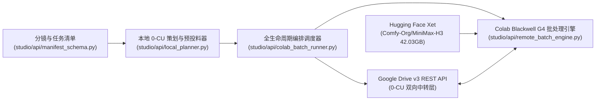
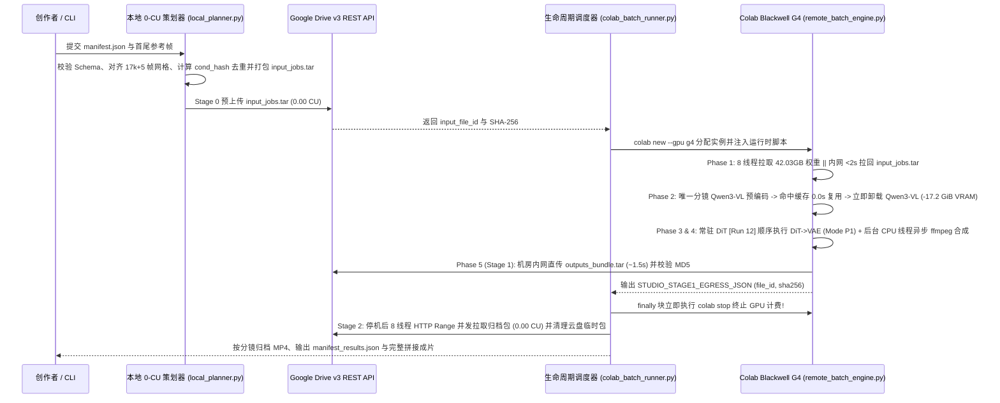

# 全局架构现状 (Architecture Overview)

> 本文件仅维护全局主干（两张 Mermaid 图 + 一组核心约束）。具体子系统或领域细节请在 `docs/architecture/` 下按需平铺新建专题 `.md` 文件。

## 1. 模块边界与源码地图

- **清单契约与 2×2 BF16 路由层（[`studio/api/manifest_schema.py`](../../studio/api/manifest_schema.py)）**：定义 `StoryboardSpec`、`RenderJobSpec`、`BatchManifest` 与 `ROUTE_PROFILES_2X2`（`model_route` $\in \{\text{"fl2va"}, \text{"ref2va"}\} \times$ `profile` $\in \{\text{"quality"}, \text{"fast"}\}$ 共 4 套全浮点 `BF16` 预设），负责画幅比例/分辨率对齐、`17k+5` 帧网格吸附、SHA-256 条件哈希计算以及按路由/档位锁定权重清单与耗时预估。
- **本地 0-CU 策划与预投料层（[`studio/api/local_planner.py`](../../studio/api/local_planner.py)）**：在未分配任何云端 GPU 前完成首尾帧（`first_frame`/`last_frame`）或多模态参考资产（`ref_images`/`ref_videos`/`ref_audios`）校验、跨任务 `cond_hash` 去重预分析、`input_jobs.tar` 未压缩打包，并以 `0.00 CU` 预推入 Google Drive REST API。
- **全生命周期编排调度器（[`studio/api/colab_batch_runner.py`](../../studio/api/colab_batch_runner.py)）**：串联本地 0-CU 路由选型（`--route fl2va|ref2va --profile quality|fast`）与预投料、Colab `--gpu g4` 实例分配、远端日志流式监控、`finally` 块毫秒级 `colab stop` 停机保护、停机后 8 线程 `HTTP Range` 0-CU 并发拉取及多镜头自动拼接。
- **云端 G4 阶段式批处理引擎（[`studio/api/remote_batch_engine.py`](../../studio/api/remote_batch_engine.py)）**：在远端 Colab G4 上按路由单选拉取对应 `BF16` 权重包（`97.55 ~ 99.51 GB`）、执行阶段式 `Qwen3-VL-32B BF16` 去重预编码（支持 `MiniMaxH3ImageToVideo` 与 `MiniMaxH3ReferenceToVideo`）并立即卸载（释放 `52.82 GiB` 显存）、常驻 `Pruned BF16 DiT` 单流连续去噪（模式 P1）、后台 CPU 异步 `ffmpeg` 音画封装及机房内网极速出向卸载。

## 2. 核心执行链路与数据流

- **关键数据结构**：`BatchManifest`、`StoryboardSpec`、`RenderJobSpec` 及 `LOCKED_RUN12_CONFIG` 定义于 [`studio/api/manifest_schema.py`](../../studio/api/manifest_schema.py)；远端至本地的阶段交接协议 `STUDIO_STAGE1_EGRESS_JSON` 定义于 [`studio/api/remote_batch_engine.py`](../../studio/api/remote_batch_engine.py) 与 [`studio/api/colab_batch_runner.py`](../../studio/api/colab_batch_runner.py)。

## 3. 系统不变量与边界约束

- **阶段式显存隔离不变量（[ADR-0005](../adr/0005-staged-batch-production-workflow.md)）**：`Qwen3-VL-32B`（`15.69 GB`）仅在阶段 1 对去重后的唯一分镜执行条件编码，编码完成后必须立即销毁并调用 `torch.cuda.empty_cache()` 释放 `17.21 GiB` 显存，严禁携载 `Qwen3-VL-32B` 进入 `DiT` 去噪阶段（见 [`studio/api/remote_batch_engine.py`](../../studio/api/remote_batch_engine.py)）。
- **单流 GPU + 异步 CPU 封装约束（锁定模式 P1，禁用模式 P2）**：在 `Run 12` 占满 Blackwell G4 SM 与 GDDR7 带宽的前提下，GPU 主流必须严格按顺序执行 `DiT_Denoise(K) -> VAE_Decode(K)`，严禁开启双 CUDA Stream 跨任务并发重叠 `VAE(K) || DiT(K+1)`；音视频编码与质量评分统一卸载至后台 CPU `ThreadPoolExecutor` 异步执行。
- **两段式零交互内网卸载与毫秒级停机约束（[ADR-0004](../adr/0004-two-stage-gdrive-rest-egress-relay.md)）**：严禁使用 `colab download`（存在 `+36.84%` Base64 膨胀税与单流慢网阻塞）或交互式 `colab drivemount` 传输归档包；远端完成 Google Drive v3 REST API 直传与 `md5Checksum` 校验后，本地调度器必须在 `finally` 块中立即调用 `colab stop` 销毁 GPU 实例，并自动清理 Google Drive 临时中转文件。
