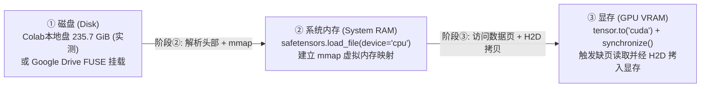

<!-- harness-ignore LNK001: outputs/ directory is ignored in git -->
# 实验 01：`H3-Base-FL2VA` 全链路基准测试（云端拉取 $\rightarrow$ 本地磁盘 $\rightarrow$ 系统内存 RAM $\rightarrow$ 显存 VRAM）

## 1. 实验目标

在 Google Colab 上部署 **MiniMax `H3-Base-FL2VA` 官方推理黄金组合（5 个文件，总计 `42.03 GB` / `39.14 GiB`）**，实测从权重获取到最终进入 **GPU 显存 (VRAM)** 的 **完整三阶段真实链路耗时**：

- **阶段 ①（磁盘落盘）**：从 Hugging Face 或 Google Drive 获取权重到本地磁盘 `/content`（或零拷贝直接读取）
- **阶段 ②（Disk $\rightarrow$ RAM）**：通过 `safetensors.torch.load_file(..., device="cpu")` 将权重读取并反序列化到系统内存（System RAM）
- **阶段 ③（RAM $\rightarrow$ VRAM）**：将张量通过 PCIe 搬运至 GPU 显存（`.to("cuda")` + `torch.cuda.synchronize()`）

我们一次性对比 **3 条端到端真实链路**：
1. **链路 B1（Drive 拷贝流）**：`Google Drive` $\rightarrow$ 拷贝至 `/content` 本地 SSD $\rightarrow$ 加载至 `RAM` $\rightarrow$ 搬运至 `VRAM`
2. **链路 B2（Drive 零拷贝直读流）**：`Google Drive` (`/content/drive`) $\rightarrow$ **不拷贝，原地直接 `load_file` 至 `RAM`** $\rightarrow$ 搬运至 `VRAM`
3. **链路 A（HF 直连下载流）**：`Hugging Face (hf_transfer)` $\rightarrow$ 下载至 `/content` 本地 SSD $\rightarrow$ 加载至 `RAM` $\rightarrow$ 搬运至 `VRAM`

---

## 2. Colab 全系可选 GPU 规格表（结合 `colab-cli` 源码与 Google 官方文档核实）

经查验本机安装的 `google-colab-cli` 源码（`colab_cli/client.py` 中的 `Accelerator` 枚举定义了 `G4`、`H100`、`A100`、`L4`、`T4` 五种 GPU 标识，且规定 `L4` 固定单规格不支持 `--high-mem`），并结合 [Google Colab 官方 Release Notes](https://colab.research.google.com/notebooks/relnotes.ipynb) 与 [Google Cloud GPU 文档](https://cloud.google.com/compute/docs/gpus) 核实硬件映射关系如下：

| `colab-cli` 参数 | 对应 GPU 硬件型号 (据官方 Release Notes / GCP 文档) | 架构 | 标称显存 (运行时可见) | High-RAM 系统内存 | 权重容载能力说明 (`42.03 GB` / `39.14 GiB` 五件套) |
| :--- | :--- | :--- | :---: | :---: | :--- |
| `--gpu G4 --high-mem` | **NVIDIA RTX PRO 6000 Blackwell Server Edition** | **Blackwell** | **96 GB GDDR7** | 随配额动态分配 | **96 GB 超大显存**可容纳全套 `39.14 GiB` 权重文件及推理激活工作区，且硬件原生支持 Blackwell FP4/INT8/FP8 指令集。 |
| `--gpu H100 --high-mem` | **NVIDIA H100** | Hopper | **80 GB HBM3** | 随配额动态分配 | **80 GB 显存**同样具备容纳全套 `39.14 GiB` 权重的显存空间，算力强但计算单元消耗费率高。 |
| `--gpu A100 --high-mem` | **NVIDIA A100-SXM4-80GB** (或 40GB) | Ampere | **80 GB** (`79.3 GiB` 实测可见) | **`167.1 GiB` (本次实测)** | ✅ **本次实测机型**。`167.1 GiB` 系统内存与 `79.3 GiB` 显存均远超 `39.14 GiB` 权重体积（40GB 机型则需配合 CPU Offload）。 |
| `--gpu L4` | **NVIDIA L4** | Ada Lovelace | **24 GB GDDR6** (`~22.5 GiB` 可见) | 固定单规格 (不支持 `--high-mem`) | 24 GB 显存无法一次性装下全套 `39.14 GiB` 权重，推理时必须依赖系统内存 CPU Offload 按阶段轮流加载模块。 |
| `--gpu T4 --high-mem` | **NVIDIA Tesla T4** | Turing | **16 GB GDDR6** (`~15 GiB` 可见) | 随配额动态分配 | ❌ **不适用**。约 15 GiB 可用显存无法装下 `19.53 GiB` (`20.97 GB`) 的主干权重，且 Turing 架构不支持原生 BF16。 |

---

## 3. 💣 核心踩雷点复盘

### 踩雷 1：官方仓库混装多套模型（整仓约 498 GB）+ 含微调冗余分支
- `MiniMaxAI/MiniMax-H3` 官方仓库同时存放了 `FL2VA/` (约 144 GB)、`Ref2VA/` (约 144 GB) 和根目录 Diffusers 格式副本 (约 210 GB)，整仓合计近 **498 GB**。
- 社区维护的 [`Comfy-Org/MiniMax-H3`](https://huggingface.co/Comfy-Org/MiniMax-H3) 仓库对 `FL2VA` 进行了推理侧瘦身（据其模型卡说明，剔除了约 13B 仅微调训练使用的 AdaLN 分支参数，并采用 `int8_convrot` 与 `nvfp4_awq` 量化及 8 步加速 LoRA），将全套 5 个推理文件体积压缩至 **`42.03 GB` (`39.14 GiB`)**，大幅降低了磁盘与显存搬运开销。

### 踩雷 2：【① 磁盘 Disk $\rightarrow$ ② 系统内存 RAM $\rightarrow$ ③ 显存 VRAM】三阶段数据流

- **为什么测试不能只停留在阶段 ①（落盘）或阶段 ②（`load_file` 到 CPU）？**
  因为 `safetensors.torch.load_file(..., device="cpu")` 默认使用 `mmap`（内存映射），在本地 SSD 上阶段 ② 仅耗时 `0.1~0.2 s`，真正的大量文件数据页读取与主机到显存（H2D）传输发生在阶段 ③ `tensor.to("cuda")` 时。如果只测到阶段 ②，就会漏掉阶段 ③ 触发的数据页读取与显存拷贝耗时。

### 踩雷 3：Google Drive 挂载盘 (`drive-fs`) 的本地缓存干扰与 FUSE 目录删除雷区
- **同会话写后读的缓存干扰**：读写 `/content/drive` 时，Colab 后台用户态守护进程 `drive-fs` 会在 `/root/.config/Google/DriveFS` 维护本地缓存。同一会话内刚写入 `/content/drive` 的文件（如本次实验中的第 2~5 个文件）在紧接着读取时会命中客户端本地缓存（跑出 `73~1012 MiB/s`），而不能代表跨会话首次读取云盘文件的速度（本次第 1 个文件 `20.97 GB` 实测为 **`46 MiB/s`**）。
- ⚠️ **高危雷区（切勿在挂载状态下强删 `DriveFS/content_cache`）**：在第一次实验中我们实测触发了该故障（见会话历史 `task-189`）：当 `/content/drive` 处于挂载状态时，对 `/root/.config/Google/DriveFS/.../content_cache` 执行 `shutil.rmtree` 会破坏 `drive-fs` 守护进程的内部缓存目录结构，导致随后写入 `/content/drive` 直接抛出 `FileNotFoundError`。因此脚本中仅执行 `echo 3 > /proc/sys/vm/drop_caches` 清理 Linux 内核可回收页缓存，不触碰 `DriveFS` 内部目录（注意：`drop_caches=3` 仅清理内核页缓存，不会清除 `DriveFS` 的用户态磁盘缓存）。

---

## 4. 测试目标文件清单（组合 1：官方默认黄金 5 件套，共 `42.03 GB`）

仓库来源：[`Comfy-Org/MiniMax-H3`](https://huggingface.co/Comfy-Org/MiniMax-H3)

| 序号 | 模块角色 | 仓库内相对路径 | 精确大小 (GB / GiB) |
| :---: | :--- | :--- | :---: |
| 1 | **FL2VA 生成主干** | `diffusion_models/minimax_h3_fl2va_pruned_int8_convrot.safetensors` | **20.97 GB** (19.53 GiB) |
| 2 | **多模态文本编码器** | `text_encoders/qwen3vl_32b_minimax_h3_nvfp4_awq.safetensors` | **15.69 GB** (14.61 GiB) |
| 3 | **视频解码器 (Video VAE)** | `vae/minimax_h3_video_vae_int8_convrot.safetensors` | **2.81 GB** (2.62 GiB) |
| 4 | **8步蒸馏加速 LoRA** | `loras/minimax_h3_fl2v_turbo_8step_v1.0_comfyui_bf16.safetensors` | **1.96 GB** (1.82 GiB) |
| 5 | **音频解码器 (Audio VAE)** | `vae/minimax_h3_audio_vae_fp32.safetensors` | **0.61 GB** (0.56 GiB) |
| **合计** | **全套推理权重** | **共 5 个 `.safetensors` 文件** | **42.03 GB (39.14 GiB)** |

---

## 5. 运行方式（支持网页端 Notebook 或本机 `colab-cli`）

### 方式一：Colab 网页端运行
1. 上传 [`colab_hf_vs_gdrive_benchmark.ipynb`](./code/colab_hf_vs_gdrive_benchmark.ipynb)。
2. **省钱技巧**：
   - **Step 2（首次把 42.03 GB 下进你的 Google Drive）**：可先在 **免费 CPU 模式** 下跑完，0 计算单元消耗！
   - **Step 3（测试拉取 + 加载到 RAM + 搬运到 GPU 显存全链路）**：切换 Runtime 到 **`G4` (RTX PRO 6000)**、**`A100`** 或 **`L4`**（开启 `High-RAM`），运行 Step 1 和 Step 3。

### 方式二：使用本机 `colab` CLI 命令行运行
```bash
# 1. 创建 G4 (RTX PRO 6000 96GB) 高内存会话并挂载 Google Drive
colab new -s h3-bench --gpu G4 --high-mem
colab drivemount -s h3-bench

# 2. 直接在远端会话执行全链路基准测试脚本
colab exec -s h3-bench -f experiments/01-hf-vs-gdrive-speed/code/benchmark.py

# 3. 测完立即释放 GPU，停止扣取计算单元
colab stop -s h3-bench
```

---

## 6. 实验结果记录表（A100-SXM4-80GB High-RAM 实测数据）

**实测硬件环境（原始日志见 [`a100_benchmark_raw.log`](./outputs/a100_benchmark_raw.log)）**：
- **① 本地磁盘 (`/content`)**：总计 `235.7 GiB` | 初始可用 `193.3 GiB`
- **② 系统内存 (`System RAM`)**：总计 `167.1 GiB` | 初始可用 `164.2 GiB`
- **③ GPU 显存 (`VRAM`)**：`NVIDIA A100-SXM4-80GB` | 总计 `79.3 GiB`（前序 `colab usage` 实测消耗费率：`6.77 CU/hr`）
- **计时口径说明**：脚本按 **`链路 A` $\rightarrow$ `链路 B1` $\rightarrow$ `链路 B2`** 顺序执行；对 5 个文件采取**逐文件获取 $\rightarrow$ `load_file(device="cpu")` $\rightarrow$ `.to("cuda")` + `torch.cuda.synchronize()` $\rightarrow$ 立即释放显存与内存**的方式累计三阶段耗时（不含计时器外的 Google Drive 备份、`sync` 及 GC 清理时间）。代码中吞吐率按 `size / (1024**2) / sec` 计算，即二进制 **`MiB/s`**（原始日志打印标签为 `MB/s`，下表已明确标注 `MiB/s` 与 `GiB/s` / `GB/s` 双口径）。

### 6.1 三条链路逐文件加载累计耗时总览（42.03 GB / 39.14 GiB）

| 链路方案（执行顺序：`A` $\rightarrow$ `B1` $\rightarrow$ `B2`） | ① 落盘耗时 (二进制 / 十进制吞吐率) | ② Disk $\rightarrow$ RAM 耗时 | ③ RAM $\rightarrow$ VRAM 耗时 (等效吞吐率) | **三阶段累计耗时** |
| :--- | :---: | :---: | :---: | :---: |
| **链路 A：Hugging Face (默认 Xet 路径) $\rightarrow$ `/content` $\rightarrow$ RAM $\rightarrow$ VRAM 🏆** | **`127.8 s`** (`314 MiB/s` / `328.9 MB/s`) | **`0.2 s`** | **`11.7 s`** (`3.35 GiB/s` / `3.59 GB/s`) | **`139.7 s` (`2.33 min`)** |
| **链路 B2：Google Drive 原地零拷贝 $\rightarrow$ RAM $\rightarrow$ VRAM** | `0.0 s` (零拷贝) | `206.0 s`* | `109.1 s`* | **`315.0 s` (`5.25 min`)*** |
| **链路 B1：Google Drive $\rightarrow$ 拷贝至 `/content` $\rightarrow$ RAM $\rightarrow$ VRAM** | `481.3 s` (`83 MiB/s` / `87.3 MB/s`)* | `0.1 s` | `11.6 s` (`3.37 GiB/s` / `3.62 GB/s`) | **`493.0 s` (`8.22 min`)*** |

> \* **缓存状态与方法学边界说明**：
> 1. **链路 B1 的混合缓存状态**：第 1 个主模型文件（`20.97 GB` / `19.53 GiB`）在前序会话已存在于云盘，本次在新 VM 会话首次通过 `/content/drive` 拷贝至 `/content` 实测耗时 **`432.2 s`（`46 MiB/s` / `48.5 MB/s`）**；而第 2~5 个文件（共 `21.06 GB`）刚在本会话链路 A 的计时器外写入 `/content/drive`，紧接着在 B1 读取时受到客户端 `DriveFS` 本地缓存影响（速率达 `73~1012 MiB/s`）。若按首文件的 `46 MiB/s` 比例估算全套 `39.14 GiB` 均处于相同未缓存状态下的拷贝耗时，总计约为 `~878–883 s`（此为外推估算值，非直接实测值）。
> 2. **链路 B2 受前序 B1 读取影响**：链路 B2 在链路 B1 之后执行，此时 5 个文件均已被 B1 读取过一次（尽管每次测试间执行了内核 `drop_caches=3`，但用户态 `DriveFS` 磁盘缓存未被清除），因此 B2 并非独立冷读测试；其中第 1 个文件阶段 ②+③ 共耗时 `203.6 + 95.8 = 299.4 s`（等效 `66.8 MiB/s` / `70.0 MB/s`），第 2~5 个文件则明显命中缓存（阶段 ② 仅 `0.1~1.7 s`）。

### 6.2 分文件三阶段明细对比（5 个权重文件逐一拆解，图中速率单位为二进制 `MiB/s`）

| 序号 | 权重模块 (`GB` / `GiB`) | **链路 A（HF 直连 $\rightarrow$ `/content`）**<br/>① 下载 \| ② 入RAM \| ③ 入VRAM | **链路 B1（Drive 拷贝 $\rightarrow$ `/content`）**<br/>① 拷贝 \| ② 入RAM \| ③ 入VRAM | **链路 B2（Drive 原地零拷贝）**<br/>① 零拷贝 \| ② 直读RAM \| ③ 入VRAM |
| :---: | :--- | :--- | :--- | :--- |
| **1** | **FL2VA 生成主干**<br/>(`20.97 GB` / `19.53 GiB`) | ① **`52.8s` (379 MiB/s)**<br/>② `0.1s` \| ③ `5.6s` | ① **`432.2s` (46 MiB/s, 本会话首读)**<br/>② `0.0s` \| ③ `5.6s` | ① `0.0s`<br/>② **`203.6s` (98 MiB/s)** \| ③ **`95.8s`** |
| **2** | **Qwen3-VL-32B 编码器**<br/>(`15.69 GB` / `14.61 GiB`) | ① **`40.3s` (371 MiB/s)**<br/>② `0.0s` \| ③ `4.4s` | ① `34.2s` (437 MiB/s, 同会话写后读)<br/>② `0.0s` \| ③ `4.3s` | ① `0.0s`<br/>② `1.7s` (缓存) \| ③ `9.7s` |
| **3** | **Video VAE 解码器**<br/>(`2.81 GB` / `2.62 GiB`) | ① **`8.8s` (306 MiB/s)**<br/>② `0.0s` \| ③ `1.0s` | ① `2.6s` (1012 MiB/s, 同会话写后读)<br/>② `0.0s` \| ③ `0.8s` | ① `0.0s`<br/>② `0.3s` (缓存) \| ③ `1.9s` |
| **4** | **8步加速 LoRA**<br/>(`1.96 GB` / `1.82 GiB`) | ① **`9.8s` (191 MiB/s)**<br/>② `0.0s` \| ③ `0.6s` | ① `4.3s` (433 MiB/s, 同会话写后读)<br/>② `0.0s` \| ③ `0.6s` | ① `0.0s`<br/>② `0.3s` (缓存) \| ③ `1.3s` |
| **5** | **Audio VAE 解码器**<br/>(`0.61 GB` / `0.56 GiB`) | ① **`16.1s` (36 MiB/s)**<br/>② `0.0s` \| ③ `0.2s` | ① `7.9s` (73 MiB/s, 同会话写后读)<br/>② `0.0s` \| ③ `0.2s` | ① `0.0s`<br/>② `0.1s` (缓存) \| ③ `0.4s` |

---

## 7. 实测核心结论与底层原理解析

### 结论 1：本次实测中 Hugging Face 直连 (`314 MiB/s`) 显著快于 Google Drive 挂载读取
- **实测对比**：在本次单轮实验中，即使链路 B1/B2 的第 2~5 个文件因同会话刚写入而受益于 `DriveFS` 本地缓存，**链路 A（总计 `139.7 s`）依然比链路 B2（`315.0 s`）快 2.25 倍、比链路 B1（`493.0 s`）快 3.53 倍**；若仅对比第 1 个未在本会话预热的 `20.97 GB` 主模型文件，链路 A 下载耗时 `52.8 s`（`379 MiB/s`），而链路 B1 从 `/content/drive` 拷贝耗时 `432.2 s`（`46 MiB/s`，慢 8.19 倍）。
- **关于 `hf_transfer` 与 `Xet` 的版本说明**：原始日志第 12 行输出的 `FutureWarning` 表明，当前 Colab 环境的 `huggingface_hub` 已弃用 `HF_HUB_ENABLE_HF_TRANSFER` 并默认切换至基于 **Xet (`reconstructing file`)** 的传输架构；本次 `314 MiB/s` (`328.9 MB/s`) 是在默认 Xet 路径（且因设置 `HF_HUB_DISABLE_IMPLICIT_TOKEN=1` 未附带 `HF_TOKEN`、未开启 `HF_XET_HIGH_PERFORMANCE=1`）下实测取得的成绩。代码现已同步补充 `HF_XET_HIGH_PERFORMANCE=1`。

### 结论 2：为什么必须测到“阶段 ③ 进入显存 (`RAM -> VRAM`)”？（`safetensors` 的 `mmap` 机制）
- 观察链路 A 和链路 B1 可以发现：阶段 ② `safetensors.torch.load_file(path, device="cpu")` 加载 `20.97 GB` 文件仅需 **`0.0~0.1 秒`**，而阶段 ③ `tensor.to("cuda")` 耗时 **`5.6 秒`**（全套 5 个文件阶段 ③ 累计耗时 **`11.7 秒`**，按文件体积折算等效吞吐率为 **`3.35 GiB/s` / `3.59 GB/s`**）。
- **底层原因**：`safetensors` 在 CPU 上默认采用 **`mmap()`（内存映射文件）** 机制。调用 `load_file(..., device="cpu")` 时仅读取解析文件头部元数据并建立基于映射存储的张量视图，无需先将全部权重复制到独立 RAM 缓冲区；而在阶段 ③ 执行 `.to("cuda")` 遍历张量数据时，才会实际触发映射页访问（若未在页缓存中则触发缺页中断从底层存储读取）、主机内存到 pinned 缓冲区中转以及 CUDA H2D 同步拷贝。
- **如果只测到 `load_file(cpu)` 而不测 `.to("cuda")` 会漏掉什么？**
  看 **链路 B2（Google Drive 零拷贝）** 的第 1 个文件（`20.97 GB`）：不仅阶段 ② `load_file` 耗时 `203.6 s`，**在随后执行阶段 ③ `.to("cuda")` 搬运到显存时，原本在本地 `/content` 盘上只需 `5.6 s` 的操作，在 `/content/drive` (FUSE) 路径上进一步阻塞了 `95.8 s`（慢了 17.1 倍）**。这直接证明：在 FUSE 挂载盘上使用 `mmap` 加载权重时，I/O 阻塞会延续到张量实际被拷贝进 GPU 显存的阶段，因此基准测试必须覆盖到 `RAM -> VRAM` 同步完成为止。

### 结论 3：后续实验（实验 02+）的工程实践建议
1. **模型拉取策略**：每次启动 Colab GPU 会话后，优先使用 **链路 A（从 Hugging Face 直接下载至 `/content` 本地盘）**，落盘后再加载进 GPU 显存。
2. **Google Drive 的合理定位**：Google Drive 适合存放**体积较小或无法从公开仓库直接拉取的私有资产**（如测试首尾帧图片、Prompt 列表、生成的 MP4 视频产物、私有小 LoRA），或作为离线备份。
