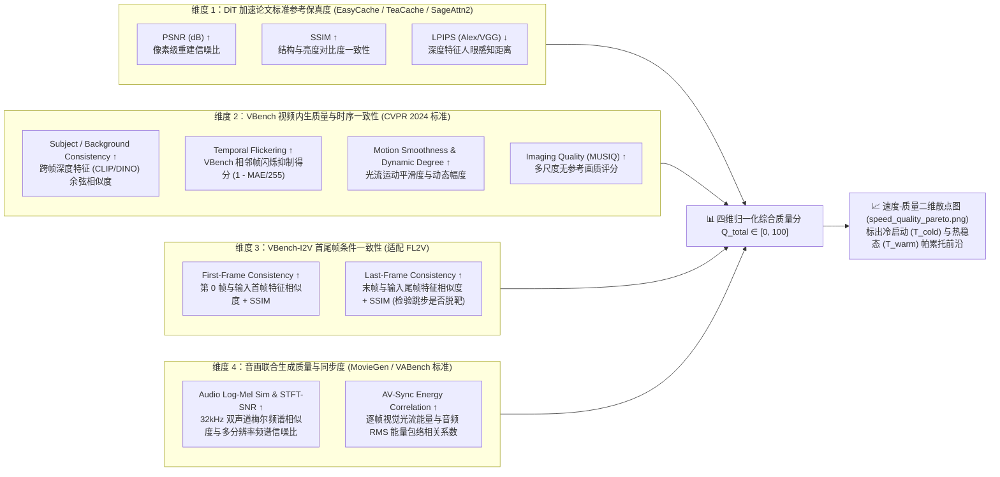

<!-- harness-ignore LNK001: outputs/ directory is ignored in git -->
# 实验 02：`H3-Base-FL2VA` 加速方案 $2^3=8$ 全组合正交消融实验（速度 × 四维质量评测）

## 1. 实验目标与前置边界

在 [ADR-01](../../docs/adr/0001-model-weights-loading-pipeline.md) 已经锁定 **`Comfy-Org/MiniMax-H3` 黄金推理五件套（`42.03 GB` / `39.14 GiB`）** 及 **链路 A（Hugging Face 直连 `/content` 本地盘加载）** 的基础上，本实验在 **`Colab A100-SXM4-80GB High-RAM`** 上对 ComfyUI 原生管线中社区呼声最高但存在争议的 **3 个核心加速开关** 进行完整的 **$2^3 = 8$ 全排列正交消融（全关 + 3单开 + 3双开 + 1三全开）**：

- **`S` (`SageAttention`)**：低比特量化注意力（`attention_sage`，INT8 QK + FP16/FP8 PV） vs 默认精确注意力（`attention_pytorch` SDPA/FA2）
- **`C` (`EasyCache`)**：ComfyUI 原生步间残差跳步缓存（`EasyCacheNode`，同时缓存视频与音频潜变量残差） vs 不跳步（完整执行 8 步）
- **`T` (`torch.compile`)**：ComfyUI 原生图编译（`TorchCompileModel(backend="inductor")`） vs Eager 动态图模式

### 核心要回答的 3 个工程问题：
1. **单开独立体检**：`SageAttention`、`EasyCache`、`torch.compile` 各自独立开启时，分别能省多少秒？各自对视频与立体声音频造成多大质量损耗？
2. **双开/三开交互效应（为什么不能只看单开？）**：
   - **双重近似误差叠加（`S + C`）**：`SageAttention`（算子近似）与 `EasyCache`（跳步近似）同时开启时，误差是否会非线性放大导致尾帧漂移、动作撕裂或音频杂音？
   - **动态跳步与静态图编译冲突（`C + T` / `S + C + T`）**：`EasyCache` 在每步动态判断 `if cumulative_change_rate < reuse_threshold: skip`，与 `torch.compile` 同时开启是否会触发 Dynamo 图断裂（Graph Break）或反复重编译，导致 $1 + 1 < 2$？
   - **编译冷启动回本线（`T` / `S + T`）**：首次编译 50 层 33B DiT 多付出的冷启动时间 $T_{\text{compile}}$，需要连续生成多少条视频（$N_{\text{breakeven}}$）才能赚回来？
3. **最优配方锁定**：基于**四维质量评测打分**绘制**速度–质量二维散点图与帕累托前沿（Pareto Frontier）**，选出 A100 上的帕累托最优加速组合并写入 **`ADR-02`**，作为后续实验 03（跨显卡硬件消融）的唯一锁定测试负载。

---

## 2. 实验控制变量与测试输入设计（如何设计能“抓出画质/音质 Bug”的测试用例？）

若使用简单静态画面作为首尾帧，即使跳过一半步数也难以暴露质量退化。因此本实验采用一套**高压力、100% 确定性可复现的标准测试集**：

| 控制项 | 设定值 | 设计理由（针对性检验的质量维度） |
| :--- | :--- | :--- |
| **硬件环境** | `Colab A100-SXM4-80GB High-RAM` | `79.3 GiB` 显存可让 `39.14 GiB` 黄金五件套 **100% 常驻显存（0 CPU Offload 干扰）**，纯粹测量计算与算子耗时 |
| **首帧 (`first_frame`)** | 官方基准图 `transparent_rgb_gaming_mouse.png`（暗黑桌面上的透明电竞鼠标，冷蓝与暖橙霓虹边缘光） | 包含**高对比度边缘、透明亚克力折射与精密金属微距纹理**，极易检验 `SageAttention` 是否导致高频细节模糊或色彩断层 |
| **尾帧 (`last_frame`)** | 基于首帧构造确定性大幅度镜头变换目标帧（缩放推近 + 视角/光效色温迁移） | 强制模型在 5 秒内完成**显著的空间几何运镜与光影过渡**，严苛检验 `EasyCache` 跳步后能否在最后一帧精准收敛到目标尾帧 |
| **Prompt（含分镜与音效）** | 官方多镜头视听 Prompt（含微距推镜、悬浮旋转及 4 层明确音效：低频脉冲底噪、清脆机械微动咔哒声、玻璃呼啸转场声、电子合成器渐强收尾） | 同时覆盖**瞬态高频音效（机械咔哒声）**与**连续谐波音乐（电子合成器）**，严苛检验音频潜变量在量化/跳步下是否破音或丢失细节 |
| **输出规格** | 分辨率 **`1344 × 768`**（官方标准 768p 16:9）<br/>时长 **`5.0 秒`** $\rightarrow$ 对齐 `17k+5` 网格为 **`124 帧` @ 24 FPS**<br/>音频 **`32 kHz` 双声道立体声** | 严格对齐官方 768p 生产规格，单次去噪打包序列含约 `3.6 万+` 多模态 Token |
| **采样器与随机种子** | `res_multistep` + `simple` 调度器，**`8 步`**（挂载 `minimax_h3_fl2v_turbo_8step_v1.0_comfyui_bf16`），固定 **`seed = 42`** | 锁死初始视频与音频随机噪声张量 `NestedTensor(video_noise, audio_noise)`，确保所有组合的像素级/频谱级差异 **100% 仅由加速开关引起** |

---

## 3. $2^3 = 8$ 全组合正交消融矩阵

在同一个 Python 进程中，先把黄金五件套加载进 A100 显存并完成 `Qwen3-VL-32B` 文本+首尾帧条件编码及首尾帧 VAE 编码（**所有 8 组共享完全相同的条件张量，彻底消除编码阶段波动**），随后依次执行以下 8 组去噪与解码：

| 组别 | 组合代号 | `S`: `SageAttention` | `C`: `EasyCache`<br/>(`thresh=0.2, 15%~95%`) | `T`: `torch.compile`<br/>(`inductor`) | 跑几次？ | 核心观测点 |
| :---: | :--- | :---: | :---: | :---: | :---: | :--- |
| **Run 1** | **`[0,0,0]` Baseline** | ❌ 关 (默认 SDPA/FA2) | ❌ 关 (满算 8 步) | ❌ 关 (Eager) | 1 次 (+1 预热) | **100% 质量锚点（Ground Truth）**：输出视频 $V_{\text{GT}}$ 与音频 $A_{\text{GT}}$ 作为后续 7 组的比对基准 |
| **Run 2** | **`[1,0,0]` Only-Sage** | **✅ 开** | ❌ 关 (满算 8 步) | ❌ 关 | 1 次 | 测量 `SageAttention` 在 8 步下的独立净提速与独立 PSNR/SSIM/音频损耗 |
| **Run 3** | **`[0,1,0]` Only-Cache** | ❌ 关 | **✅ 开** (动态跳步) | ❌ 关 | 1 次 | 记录 8 步中实际跳过了哪几步（`steps_skipped`），检验跳步帧是否引发画面卡顿或尾帧不收敛 |
| **Run 4** | **`[0,0,1]` Only-Compile** | ❌ 关 | ❌ 关 (满算 8 步) | **✅ 开** | **连跑 2 次**<br/>(4a 冷编译 + 4b 热稳态) | 分离测量首次编译冷启动耗时 $T_{\text{cold}}$ 与第 2 次热运行耗时 $T_{\text{warm}}$，检验编译是否改变数值输出 |
| **Run 5** | **`[1,1,0]` Sage+Cache** | **✅ 开** | **✅ 开** | ❌ 关 | 1 次 | **【免编译极速组】** 检验“低比特算子 + 残差跳步”双重近似叠加是否触发画质/音质雪崩 |
| **Run 6** | **`[1,0,1]` Sage+Compile** | **✅ 开** | ❌ 关 (满算 8 步) | **✅ 开** | **连跑 2 次**<br/>(6a 冷 + 6b 热) | **【高保真极速组】** 检验不跳步前提下，`SageAttention` 与 `torch.compile` 叠加的稳态极限速度 |
| **Run 7** | **`[0,1,1]` Cache+Compile** | ❌ 关 | **✅ 开** | **✅ 开** | **连跑 2 次**<br/>(7a 冷 + 7b 热) | **【冲突验证组】** 检验 `EasyCache` 的动态跳步分支是否导致 `torch.compile` 图断裂或重编译降速 |
| **Run 8** | **`[1,1,1]` All-Three** | **✅ 开** | **✅ 开** | **✅ 开** | **连跑 2 次**<br/>(8a 冷 + 8b 热) | **【三全开极限组】** 测量三者全开时的极限速度、实际跳步数与最终质量留存度 |

---

## 4. 核心设计：怎么科学地测试“质量”？（四维质量评测体系）

速度只需要看计时器，但视频与音频生成的“质量”如果只看单一的平均 PSNR，极易被误导（例如：前 6 帧完全一样 PSNR=40dB，最后 2 帧跳步崩坏 PSNR=15dB，一平均还是 28dB，但视频根本不能看）。

因此我们设计了 **“全参考轨迹对比 + 任务内生质量 + 音频频谱保真 + 人工可视化盲测包”** 的四维质量评测体系：



### 4.1 维度一：DiT 加速论文标准有参考保真度（Reference Fidelity，$S_{\text{ref}} \in [0, 100]$）
在 **EasyCache**（`arXiv:2507.02860`）、**TeaCache**（`CVPR 2025`）、**MagCache** 与 **SageAttention2**（`ICLR 2025`）等所有主流视频扩散加速论文中，衡量“加速算子/跳步缓存是否破坏原模型生成分布”的**唯一标准三件套**即为同随机种子（`seed = 42`）下相对于无加速基准组（`Run 1`）的 **`PSNR`、`SSIM`、`LPIPS`**：
1. **峰值信噪比（`PSNR_mean` & `PSNR_min`，单位 dB $\uparrow$）**：
   $$\text{PSNR}_t = 10 \log_{10} \left( \frac{1.0}{\text{MSE}(V_{\text{GT}}[t], V_{\text{test}}[t]) + 10^{-10}} \right)$$
   - 对标参考：在 `EasyCache` 原论文（HunyuanVideo）中，`TeaCache` 约为 `23.85 dB`，而 `EasyCache` 可达 `32.66 dB`。同时额外记录 124 帧中的最低值 `PSNR_min` 以捕捉跳步瞬间的单帧劣化。
2. **结构相似度（`SSIM_mean` $\in [0, 1] \uparrow$）**：
   - 衡量亮度、对比度与空间几何结构保持度（`EasyCache` 论文基准通常在 `0.82 ~ 0.93` 区间）。
3. **深度感知距离（`LPIPS_mean` $\downarrow$）**：
   - 使用预训练感知网络（AlexNet/VGG）计算深层视觉特征距离，比纯像素指标更贴合人眼感受（越低越好，`EasyCache` 论文基准通常在 `0.05 ~ 0.17` 区间）。
4. **维度一归一化得分 $S_{\text{ref}}$**（以 `Run 1 = 100.0` 为满分基准）：
   $$S_{\text{ref}} = 100 \times \left( 0.35 \cdot \min\left(1, \frac{\text{PSNR}}{40.0}\right) + 0.35 \cdot \text{SSIM} + 0.30 \cdot \max\left(0, 1 - \frac{\text{LPIPS}}{0.30}\right) \right)$$

### 4.2 维度二：`VBench` 视频内生质量与时序一致性（Intrinsic Video Quality，$S_{\text{vbench}} \in [0, 100]$）
仅看相对于 `Run 1` 的像素误差还不够——哪怕加速后的视频扩散轨迹与 `Run 1` 略有偏移，只要它自身不闪烁、主体不变形、画质清晰，依然是高质量视频。因此本维度直接对标学术界最权威的 **`VBench`（CVPR 2024）** 视频质量子维度：
1. **主体与背景跨帧一致性（`Subject & Background Consistency` $\uparrow$）**：
   - 按照 `VBench` 标准，提取视频各帧的深度视觉特征嵌入（CLIP / DINO 视觉特征），计算相邻帧与首帧的余弦相似度均值，衡量人物/物体在运动中是否发生身份崩坏或背景扭曲。
2. **时序闪烁抑制得分（`Temporal Flickering Score` $\uparrow$）**：
   - 采用 `VBench` 官方定义，计算相邻帧高频像素差分均值 $\text{MAE}_{t, t+1}$，并映射为无闪烁得分 $1.0 - \text{MAE}/255.0$，专门抓出 `EasyCache` 跳步复用与重算交替时的帧间高频闪烁。
3. **光流运动平滑度与动态度（`Motion Smoothness & Dynamic Degree` $\uparrow$）**：
   - 使用稠密光流（Optical Flow）评估帧间运动向量的连续性，防止因缓存跳步出现“画面突然定格半秒再瞬移”的抽帧现象。
4. **单帧成像质量（`Imaging Quality` $\uparrow$）**：
   - 评估单帧清晰度、无涂抹与无伪影程度。
5. **维度二归一化得分 $S_{\text{vbench}} \in [0, 100]$**：由上述 4 项 `VBench` 子指标按等权重归一化合成。

### 4.3 维度三：`VBench-I2V` 首尾帧条件锚定一致性（FL2V Condition Fidelity，$S_{\text{fl2v}} \in [0, 100]$）
针对 `H3-Base-FL2VA` 核心的**首尾帧受控生成（First-Last-Frame-to-Video）**任务，扩展 **`VBench++ / VBench-I2V`** 的 `Video-Image Consistency` 指标：
1. **首帧锚定保真度（`First-Frame Consistency` $\uparrow$）**：
   - 计算生成视频第 0 帧 `V[0]` 与输入首帧 `Input_First` 的深度特征余弦相似度（`CLIP-I`）与结构相似度（`SSIM_first`）。
2. **尾帧收束保真度（`Last-Frame Consistency` $\uparrow$）**：
   - 计算生成视频末帧 `V[123]` 与输入尾帧 `Input_Last` 的深度特征余弦相似度与结构相似度（`SSIM_last`）。直接量化 `EasyCache` 在后半程（`15% ~ 95%` 步数区间）跳步时，是否导致**末端轨迹脱靶、无法精准收敛到目标尾帧**。
3. **维度三归一化得分 $S_{\text{fl2v}} \in [0, 100]$**：
   $$S_{\text{fl2v}} = 100 \times \left( 0.4 \cdot \text{Sim}_{\text{first}} + 0.6 \cdot \text{Sim}_{\text{last}} \right)$$

### 4.4 维度四：音画联合生成质量与同步度（Audio & AV-Sync Quality，$S_{\text{audio}} \in [0, 100]$）
对标 **Meta `Movie Gen Audio Bench`**、**`VABench`** 与 **`MMAudio`** 的音视频联合评测范式，针对 `H3-Base-FL2VA` 原生同步输出的 `32kHz` 立体声波形 $A \in [-1, 1]^{2 \times L}$：
1. **多分辨率频谱信噪比与梅尔频谱相似度（`Multi-Res STFT-SNR` & `Log-Mel Cosine Sim` $\uparrow$）**：
   - 在多尺度短时傅里叶变换（STFT）和 Log-Mel 频谱域对比加速组与 `Run 1` 基准组的声学特征，检验 `SageAttention` / `EasyCache` 作用于音频分支时是否引入金属电流音、底噪或高频截断。
2. **音画能量包络同步率（`AV-Sync Envelope Correlation` $\uparrow$）**：
   - 将音频按视频帧率（`24 fps`，共 124 帧）切分为帧级 RMS 能量序列 $E_{\text{audio}}(t)$，与视觉帧级光流运动能量序列 $E_{\text{motion}}(t)$ 计算相关系数一致性，确保加速后声效瞬态（如齿轮咬合声、机械运转声）与画面动作依然严丝合缝。

---

## 5. 综合质量打分与速度–质量二维帕累托前沿（Pareto Frontier）分析

本实验**不设置人为拍脑袋的硬性淘汰红线（Quality Gate）**，而是通过四维质量评测体系为全部 8 组配置计算客观得分，并绘制**速度–质量二维散点图与帕累托前沿（Pareto Frontier）**：

### 5.1 四维综合质量总分（$Q_{\text{total}} \in [0, 100]$）
将四个维度的归一化百分制得分按如下权重汇总为综合质量得分 $Q_{\text{total}}$（同时在报告中完整保留各子维度明细）：
$$Q_{\text{total}} = 0.35 \cdot S_{\text{ref}} + 0.25 \cdot S_{\text{vbench}} + 0.25 \cdot S_{\text{fl2v}} + 0.15 \cdot S_{\text{audio}}$$

### 5.2 速度–质量二维散点图与帕累托前沿（`speed_quality_pareto.png`）
脚本自动生成一张双子图的高清二维帕累托前沿分析图：
1. **横轴（Speed / Latency）**：
   - **左图（单次/短会话场景）**：采用**冷启动端到端耗时 $T_{\text{cold}}$（秒）**（或相对加速比 $\text{Speedup}_{\text{cold}} = T_{\text{Run1}} / T_{\text{cold}}$）。
   - **右图（常驻/批量生成场景）**：采用**热稳态端到端耗时 $T_{\text{warm}}$（秒）**（或相对加速比 $\text{Speedup}_{\text{warm}} = T_{\text{Run1}} / T_{\text{warm}}$）。
2. **纵轴（Quality）**：四维综合质量得分 $Q_{\text{total}} \in [0, 100]$（同时支持以纯参考保真度 `PSNR / LPIPS` 作为副轴对照）。
3. **帕累托前沿（Pareto Frontier）标定**：
   - 若配置 $A$ 比配置 $B$ **既快（耗时更短）且质量更高（$Q_{\text{total}}$ 更高）**，则称 $A$ 帕累托支配（Dominate）$B$。
   - 所有不被任何其他配置支配的点共同构成 **帕累托最优前沿（Pareto Frontier）**，在图中用高亮折线连接并标注，直观展示“每多换取 `1.0x` 加速比需要付出多少质量分代价”，据此选出 `ADR-02` 的帕累托最优组合（及 `torch.compile` 盈亏平衡条数 $N_{\text{breakeven}}$）。

---

## 6. 实验目录文件规划与执行流程

```text
experiments/02-a100-acceleration-ablation/
├── README.md                        # 本实验方案与实测结果报告
├── code/
│   ├── run_ablation.py                  # A100 自动化 8 组全组合消融与四维质量评测脚本
├── outputs/                         # 从 Colab 拉回的实测产物目录
│   ├── a100_ablation_raw.log        # 完整终端实测日志
│   ├── ablation_metrics.json        # 8 组速度 + 四维质量分 + 帕累托最优标记结构化数据
│   ├── speed_quality_pareto.png     # 速度 vs 四维质量二维散点图与帕累托前沿曲线 (冷启动 + 热稳态)
│   ├── keyframe_strip_8runs.png     # 8 组 × 5 关键帧 (0%/25%/50%/75%/100%) 高清对比大图
│   ├── frame_metrics_curves.png     # 124 帧逐帧 PSNR 曲线与时序一致性曲线图
│   └── comparison_grid_8runs.mp4    # 2×4 八宫格同步对比视频 (含 32kHz 立体声)
```

### 标准执行命令（通过 `colab-cli` 自动化运行）：
```bash
# 1. 创建 A100-SXM4-80GB High-RAM 会话
colab new -s h3-exp02 --gpu A100 --high-mem

# 2. 执行 8 组全组合消融与四维质量评测脚本
colab exec -s h3-exp02 -f experiments/02-a100-acceleration-ablation/code/run_ablation.py

# 3. 拉回生成的帕累托前沿图、对比大图、八宫格视频与 JSON 报表
colab pull -s h3-exp02 /content/exp02_outputs/ experiments/02-a100-acceleration-ablation/outputs/

# 4. 立即停止会话释放 A100 算力
colab stop -s h3-exp02
```
