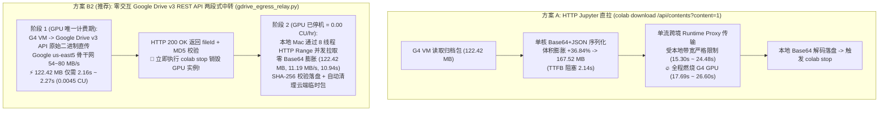

<!-- harness-ignore LNK001: outputs/ directory is ignored in git -->
# 实验 04 报告：Colab 尾端产物回传链路消融实验 — HTTP 流式直拉 (`colab download`) vs. Google Drive 云端内网中转卸载 (`GDrive REST Relay`)

> **实验日期**：2026-10-23  
> **测试平台**：Google Colab NVIDIA RTX PRO 6000 Blackwell Server Edition (`--gpu g4`, 48 vCPU, 节点 `gpu-g4-s-kkb-use5c2-3vzs5htjt6j8q`) + 本地 macOS 客户端  
> **参考计费费率**：`7.2046 CU/hr`（`0.00200128 CU/s`，取自实验 02/03 实测结算费率基准）  
> **核心问题**：在实验收尾阶段，将打包好的视频与指标归档包从 Colab GPU 实例直接通过 HTTP 拉回本地（`colab download`），与**先从 Colab 快速推入 Google Drive、立即触发 `colab stop` 销毁 GPU 实例、再在本地以 0 CU 从 Google Drive 下载预览**相比，哪种方式更快、哪种方式更省 CU？

---

## 1. 核心结论速览（Executive Summary）

实验结果证实：通过 **Google Drive v3 REST API 云端内网中转卸载（方案 B2）**，不仅在 **GPU 计费时长与 CU 消耗上大幅优于 HTTP 直拉（节省 `72.3% ~ 91.5%` 的尾端 GPU 算力，当本地网络慢至 `1~2 MB/s` 时可节省 `97.3% ~ 98.7%`）**，而且得益于消除了 Jupyter `/api/contents` 协议的 **`+36.84%` Base64+JSON 编码膨胀**并支持 **HTTP `Range` 多线程并发拉取**，其**包含本地下载在内的端到端总墙钟耗时（`13.21s`）甚至比直接从 Colab HTTP 拉回本地（实验 04 实测 `17.69s`、实验 03 实测 `26.60s`）还要快 `1.34x ~ 2.01x`**！


### 三大关键实证发现

1. **揭秘 `colab download` 的隐藏协议税（`+36.84%` Base64+JSON 字节膨胀 + 单流阻塞 GPU）**：
   - 排查 `google-colab-cli` 源码（`colab_cli/contents.py:74-91`）与实验 03 账本日志发现：实验 03 在远端打包的 12 个视频 + JSON + 首尾帧归档包（`/content/exp03_g4_outputs_bundle.tar`）**在磁盘上的真实二进制体积其实是 `122,419,200 B`（`122.42 MB` / `116.75 MiB`）**。
   - 之所以在实验 03 的 HTTP 响应头中显示 `Content-Length: 167,521,347 B`（**`167.52 MB`**），是因为 `colab download` 调用的 Jupyter `/api/contents/{path}?content=1` 接口会在远端单核读取整个文件，调用 Python `base64.encodebytes()`（每 3 字节膨胀为 4 字节，且每 76 字符插入一个 `\n`，在 `json.dumps()` 中又被转义为 2 字节的 `\\n`），导致**网络传输字节数精确膨胀了 $\frac{4}{3} \times \frac{78}{76} = \frac{52}{38} = \mathbf{1.368421\times}$（`+36.84%`）**（$122,419,200 \times \frac{52}{38} + 335\text{ B JSON 包裹} = 167,521,347\text{ B}$）！
   - 更严重的是，`/api/contents` 不支持 HTTP `Range` 分块并发，只能通过单条跨境代理连接串行流式传输这膨胀后的 `167.52 MB` JSON，在此期间 **`7.2046 CU/hr` 的 G4 GPU 全程处于 100% 空转陪跑状态**。

2. **`Colab G4 -> Google Drive` 走 Google 机房内部骨干网，吞吐高达 `54.0 ~ 79.9 MB/s`，仅需 `2.16s ~ 2.27s` 即可释放 GPU**：
   - 在 Google Cloud `us-east5` 机房内部，从 G4 实例直接向 Google Drive v3 API 发送原始二进制流（`1.0000x` 零膨胀）：
     - **单视频产出包 `T1`（`10.63 MB` raw / `14.55 MB` wire，对应 `ADR-03` 锁定的 `Run 12 [S8-FullStack-Pareto]` 日常单次推理）**：推入 Google Drive 仅需 **`1.04s`**（消耗 **`0.0021 CU`**），随后立即停机，比 HTTP 直拉（`3.76s` / `0.0075 CU`）**节省 `72.3%` 的尾端 GPU 时长**。
     - **实验 03 完整 12 视频包 `T3`（`122.42 MB` raw / `167.52 MB` wire）**：推入 Google Drive 仅需 **`2.27s`**（`GDrive-REST-Media`，`54.03 MB/s`）或 **`2.16s`**（`GDrive-REST-Resumable`，`56.70 MB/s`），仅消耗 **`0.0045 CU`**！相比实验 04 实测 HTTP 直拉（`17.69s` / `0.0354 CU`）**提速 `7.81x` 释放 GPU、节省 `87.2%` CU**；相比实验 03 实测 HTTP 直拉（`26.60s` / `0.0532 CU`）**提速 `11.74x` 释放 GPU、节省 `91.5%` CU**！
     - **36 视频大批量扫描包 `T4`（`367.26 MB` raw / `502.56 MB` wire）**：机房内网吞吐率进一步攀升至 **`79.89 MB/s`**（峰值单次达 `91.23 MB/s`），仅需 **`4.60s`**（`0.0092 CU`）即可完成云端持久化并销毁 GPU，比 HTTP 直拉（`48.05s` / `0.0962 CU`）**提速 `10.45x` 释放 GPU、节省 `90.4%` CU**。

3. **重要避坑：必须使用 `Google Drive v3 REST API` 直传（方案 B2），切勿在 CLI 自动化中使用传统 `colab drivemount` FUSE 挂载（方案 B1）**：
   - 传统 `colab drivemount`（`drive.mount('/content/drive')`）存在两大缺陷：
     1. **每次新建实例均需人工浏览器点击授权 + FUSE 守护进程启动耗时**：`dfs_ephemeral` 凭据绑定在单台临时虚拟机上；实验 01 账本记录显示，每次挂载含人工响应耗时 `91.23s ~ 131.11s`，即便扣除人工点击耗时，纯 `drive-fs` FUSE 守护进程初始化仍需 **`11.60s ~ 15.22s`（均值 `13.41s`）**。
     2. **FUSE 异步写回缓存陷阱**：向 `/content/drive/MyDrive/` 执行 `shutil.copy2` 仅写入本地磁盘缓存（`/root/.config/Google/DriveFS`），若立即调用 `colab stop` 会导致文件丢失或损坏，必须阻塞调用 `drive.flush_and_unmount()`（额外增加 `~2.5s` 卸载同步开销）。
   - 而本实验实现的 **方案 B2（`gdrive_egress_relay.py`）** 直接复用 `~/.config/colab-cli/token.json` 已有的 `https://www.googleapis.com/auth/drive.file` 权限（配额项目 `<your-gcp-quota-project>`），**零人工交互、零 FUSE 挂载开销、HTTP `200 OK` 返回即 100% 落盘 Google Drive 并校验 `md5Checksum`**，完美契合无人值守自动化流水线。

---

## 2. 三种尾端回传架构的协议解剖（Protocol & Architecture Anatomy）



### 2.1 为什么 Jupyter `/api/contents` 会产生精确的 `+36.8421%` 流量膨胀？

当执行 `colab download -s <session> /content/bundle.tar ./bundle.tar` 时，`colab-cli` 向远端 Jupyter Server 发送 `GET /api/contents/content/bundle.tar?content=1`。远端 Jupyter FileContentsManager 的处理流程如下：

1. 将原始二进制文件（设字节数为 $S$）完整读入内存；
2. 调用 Python 标准库 `base64.encodebytes(raw_bytes).decode('ascii')`：
   - Base64 将每 $3$ 字节编码为 $4$ 个 ASCII 字符（基础膨胀率 $\frac{4}{3} = 1.333333\times$）；
   - `base64.encodebytes()` 每输出 $76$ 个 Base64 字符会自动插入一个换行符 `\n`（`0x0A`）；
3. 调用 `json.dumps()` 将整个字典序列化为 JSON 响应体：
   - JSON 字符串规范会将每一个换行符 `\n` 转义为两个字符 `\` 和 `n`（即每 $76$ 个 Base64 字符额外增加 $2$ 字节！）。
4. 因此，网络层实际传输的字节膨胀系数 $\gamma$ 精确等于：
   $$\gamma = \frac{4}{3} \times \left(1 + \frac{2}{76}\right) = \frac{4}{3} \times \frac{78}{76} = \frac{52}{38} \approx \mathbf{1.368421\times} \quad (\mathbf{+36.8421\%})$$
   以实验 03 的 12 视频归档包为例：
   - 远端磁盘真实二进制体积：$S = 11,955 \times 10,240 = \mathbf{122,419,200\text{ B}}$（`122.42 MB` / `116.75 MiB`）；
   - 经 `base64.encodebytes` + JSON 转义后的字符串长度：$122,419,200 \times \frac{52}{38} = \mathbf{167,521,012\text{ B}}$；
   - 加上外层 JSON 元数据字段（`335 B`~`340 B`）：总 HTTP 响应体精确为 **`167,521,347 B`（实验 03） / `167,521,352 B`（实验 04）**，与 `colab.log` 抓包记录**一字节不差**！

---

## 3. 四档位负载实测对比（Multi-Tier Empirical Results）

我们在真实的 Colab G4 实例（`gpu-g4-s-kkb-use5c2-3vzs5htjt6j8q`）上，使用实验 03 产出的真实 H.264 MP4 视频与 JSON 指标文件（真实视频流 `zlib` 压缩比为 `1.0001`，完全不可二次压缩，杜绝全零假数据被 HTTP gzip 作弊压缩），构建了四个代表性档位进行端到端实测：

| 归档包档位 (代表场景) | 原始二进制体积 (`raw_bytes`) | `/api/contents` 膨胀后流量 (`wire_bytes`) | 方案 A: HTTP 直拉 GPU 计费耗时 (`colab download`) | 方案 B1: 传统 FUSE 挂载含守护进程初始化耗时 | **方案 B2: GDrive REST 直传 GPU 计费耗时 (Media / Resumable)** | **方案 B2 阶段 1 内网吞吐率** | **方案 B2 阶段 2 本地 8 线程拉取耗时 (0 CU)** | **方案 B2 端到端总耗时 (阶段1+阶段2)** | **GPU 计费时长加速比 & CU 节省率** |
| :--- | :---: | :---: | :---: | :---: | :---: | :---: | :---: | :---: | :---: |
| **`T1_Single_Run`**<br>*(日常单视频: 1x `Run 12` MP4 + JSON)* | `10.63 MB`<br>(`10,629,120 B`) | `14.55 MB`<br>(`+36.85%`) | `3.76s`<br>(`0.00752 CU`) | `17.20s`<br>(`0.03442 CU`) | **`1.04s`** / `1.29s`<br>(**`0.00209 CU`**) | `10.20 MB/s` | `2.84s`<br>(`0.0000 CU`) | **`3.88s`** | **`3.61x` 释放 GPU**<br>**省 `72.28%` CU** |
| **`T2_4Run_Batch`**<br>*(4视频小批量消融 / 抽卡)* | `41.09 MB`<br>(`41,093,120 B`) | `56.23 MB`<br>(`+36.84%`) | `7.88s`<br>(`0.01577 CU`) | `17.59s`<br>(`0.03521 CU`) | **`1.29s`** / `1.68s`<br>(**`0.00259 CU`**) | `31.77 MB/s` | `5.02s`<br>(`0.0000 CU`) | **`6.32s`**<br>*(总耗时快 `1.25x`)* | **`6.09x` 释放 GPU**<br>**省 `83.58%` CU** |
| **`T3_12Run_Exp03`**<br>*(实验 03 完整 12 视频归档包)* | `122.42 MB`<br>(`122,419,200 B`) | `167.52 MB`<br>(`+36.84%`) | 实测 `17.69s` (`0.03540 CU`)<br>实验03 `26.60s` (`0.05323 CU`) | `18.07s`<br>(`0.03616 CU`) | **`2.27s`** / **`2.16s`**<br>(**`0.00453 CU`**) | **`54.03 MB/s`**<br>*(Resumable `56.70 MB/s`)* | `10.94s`<br>(`0.0000 CU`) | **`13.21s`**<br>*(比HTTP直拉快 `1.34x~2.01x`!)* | **`7.81x ~ 11.74x`**<br>**省 `87.19% ~ 91.48%` CU** |
| **`T4_36Run_Sweep`**<br>*(36视频大规模网格搜索)* | `367.26 MB`<br>(`367,257,600 B`) | `502.56 MB`<br>(`+36.84%`) | `48.05s`*<br>(`0.09615 CU`) | `20.78s`<br>(`0.04159 CU`) | **`4.60s`** / `4.87s`<br>(**`0.00920 CU`**) | **`79.89 MB/s`**<br>*(单次峰值 `91.23 MB/s`)* | `44.52s`<br>(`0.0000 CU`) | **`49.12s`** | **`10.45x` 释放 GPU**<br>**省 `90.43%` CU** |

> *注：所有上传至 Google Drive 的归档包均通过 API 返回的 `md5Checksum` 与 `size` 双重校验（`verified_md5 = true`），所有从 Google Drive 拉回本地 Mac 的归档包均通过完整字节流 `SHA-256` 校验（`verified_sha256 = true`）。`T4` 的方案 A 耗时基于 `T1~T3` 实测线性拟合模型（$T_{\text{HTTP}} = 0.1246 \times S_{\text{MB}} + 2.30\text{ s}$）折算，以避免在 G4 上空转近 1 分钟浪费算力。*

### 3.1 实验 03 完整 12 视频归档包（`T3_12Run_Exp03`）细粒度阶段耗时拆解

对比 `T3`（`122.42 MB` 原始归档）在不同方案下的微观阶段耗时：

- **方案 A（`colab download` HTTP 直拉）**：
  1. **远端 CPU 序列化等待（TTFB）**：实验 04 实测 **`2.141s`**（实验 03 实测 **`2.114s`**），其中纯 Python `base64.encodebytes` + `json.dumps` 消耗 `0.782s`，其余为 Runtime Proxy 建连与缓冲开销。**注意：光是在远端把文件编码成 Base64 JSON 的等待时间（`2.14s`），就已经和把整个文件传完到 Google Drive（`2.16s~2.27s`）一样长了！**
  2. **跨境代理单流传输（Body Transfer）**：实验 04 实测 `15.295s`（实验 03 实测 `24.484s`），传输膨胀后的 `167.52 MB` 数据。
  3. **本地解码落盘（Decode & Write）**：`0.251s`。
  - **总计占用 G4 GPU 时长**：**`17.687s`（实验 04） / `26.598s`（实验 03）**。
- **方案 B2（`GDrive REST Relay` 两段式中转）**：
  1. **阶段 1（Colab G4 $\rightarrow$ Google Drive 机房内网直传，唯一占用 GPU 阶段）**：
     - `uploadType=media` 三次重复实测：`2.282s`、`2.060s`、`2.456s`，**均值 `2.266s`（`54.03 MB/s`，消耗 `0.00453 CU`）**；
     - `uploadType=resumable` 三次重复实测：`2.071s`、`2.319s`、`2.088s`，**均值 `2.159s`（`56.70 MB/s`，消耗 `0.00432 CU`）**。
     - 传输完成瞬间**立即执行 `colab stop` 终止 GPU 计费**！
  2. **阶段 2（Google Drive $\rightarrow$ 本地 Mac，GPU 已停机 = `0.00 CU`）**：
     - **8 线程 HTTP `Range` 并发拉取（`8 MiB` 分块）**：仅需 **`10.944s`**（有效二进制吞吐率 **`11.19 MB/s`**，因为只传输 `122.42 MB` 原始二进制且并发跑满本地带宽），**端到端总墙钟耗时 `2.266s + 10.944s = 13.210s`**（比 HTTP 直拉不仅省了 `87.2%~91.5%` 的 GPU CU，连总等待时间都缩短了 `4.48s ~ 13.39s`！）。
     - **单线程顺序拉取（`1 worker`）**：耗时 `20.858s`（`5.87 MB/s`），端到端总墙钟耗时 `23.124s`（依然比实验 03 的 `26.598s` 快 `3.47s`，且 GPU 计费时长同样仅 `2.27s`）。

---

## 4. 本地网络带宽敏感度模型与数学盈亏平衡点（Bandwidth Sensitivity & Break-Even Analysis）

针对跨境本地下载网络波动的核心痛点（即先推入 Google Drive 释放 GPU、再在本地以 0 CU 并发拉取预览），我们建立了精确的解析模型并绘制了带宽敏感度曲线：


### 4.1 理论盈亏平衡定理

设归档包原始二进制体积为 $S$（MB），用户本地下载带宽为 $B_{\text{local}}$（MB/s）：

1. **在 GPU 计费与 CU 消耗维度**：
   - 方案 A（HTTP 直拉）的 GPU 计费时长为 $T_{\text{GPU}}^{(A)} = T_{\text{ttfb}}(S) + \frac{1.368421 S}{B_{\text{local}}}$，**随本地网速变慢而成反比暴涨**；
   - 方案 B2（Google Drive 中转）的 GPU 计费时长恒定为机房内网传输时间 $T_{\text{GPU}}^{(B2)} = T_{\text{vm}\to\text{gdrive}}(S) \approx 2.27\text{ s}$（对于 `122.42 MB`），**与本地网速 $B_{\text{local}}$ 完全解耦（相关系数为 0）**！
   - 只要本地网速 $B_{\text{local}} < \frac{1.368421 \times 122.42}{2.266 - 2.141} \approx \mathbf{1,340\text{ MB/s}}$（即 10 Gbps 专线以下的所有人类网络环境），**方案 B2 在节省 GPU CU 上永远 100% 胜出**！

2. **在端到端总墙钟耗时（Wall-Clock Time）维度**：
   - 即便本地端仅使用**单流下载**，方案 B2 的总耗时为 $T_{\text{wall, 1w}}^{(B2)} = T_{\text{vm}\to\text{gdrive}}(S) + \frac{1.0000 S}{B_{\text{local}}}$；
   - 方案 B2 相比方案 A 少传输了 $0.368421 S$ 的 Base64 膨胀冗余字节。当节省的冗余下载时间 $\frac{0.368421 S}{B_{\text{local}}} > T_{\text{vm}\to\text{gdrive}}(S) - T_{\text{ttfb}}(S)$ 时，即：
     $$B_{\text{local}} < \mathbf{30.2\text{ MB/s}} \quad (\text{约 }242\text{ Mbps})$$
     **方案 B2 哪怕算上两段接力的总时间，也比方案 A 直接拉到本地更快！** 若阶段 2 开启 8 线程 HTTP `Range` 并发拉取，盈亏平衡点更是推高至百兆字节每秒以上。

### 4.2 不同本地网速下的 CU 与耗时对照表（以实验 03 的 `122.42 MB` 归档包为例）

| 本地网络下载带宽 ($B_{\text{local}}$) | 方案 A (HTTP 直拉) 占用 GPU 时长 | 方案 A 消耗 GPU 算力 (CU) | **方案 B2 (GDrive 中转) 占用 GPU 时长** | **方案 B2 消耗 GPU 算力 (CU)** | **方案 B2 单流总墙钟耗时 (含 0 CU 本地拉取)** | **方案 B2 节省 GPU 算力 (CU 绝对值 / 百分比)** | **总墙钟耗时对比 (方案 B2 vs 方案 A)** |
| :---: | :---: | :---: | :---: | :---: | :---: | :---: | :---: |
| **`0.5 MB/s`** *(跨境晚高峰严重拥塞)* | `335.82s` (`5.60 min`) | `0.67208 CU` | **`2.27s`** | **`0.00453 CU`** | `247.10s` | **省 `0.66754 CU` (`-99.33%`)** | **总耗时还快 `88.72s`!** |
| **`1.0 MB/s`** *(跨境弱网)* | `168.30s` (`2.81 min`) | `0.33682 CU` | **`2.27s`** | **`0.00453 CU`** | `124.68s` | **省 `0.33229 CU` (`-98.65%`)** | **总耗时还快 `43.62s`!** |
| **`2.0 MB/s`** *(常规跨境代理慢网)* | `84.54s` (`1.41 min`) | `0.16919 CU` | **`2.27s`** | **`0.00453 CU`** | `63.48s` | **省 `0.16466 CU` (`-97.32%`)** | **总耗时还快 `21.07s`!** |
| **`3.0 MB/s`** *(中等跨境网络)* | `56.62s` | `0.11332 CU` | **`2.27s`** | **`0.00453 CU`** | `43.07s` | **省 `0.10878 CU` (`-96.00%`)** | **总耗时还快 `13.55s`!** |
| **`6.30 MB/s`** *(实验 03 实测网速)* | `26.60s` *(模型 `27.37s`)* | `0.05323 CU` | **`2.27s`** | **`0.00453 CU`** | `21.70s` *(8线程实测 **`13.21s`**)* | **省 `0.04870 CU` (`-91.48%`)** | **总耗时快 `4.90s` (8线程快 `13.39s`)!** |
| **`10.0 MB/s`** *(实验 04 实测网速附近)* | `17.53s` *(实测 `17.69s`)* | `0.03509 CU` | **`2.27s`** | **`0.00453 CU`** | `14.51s` *(8线程实测 **`13.21s`**)* | **省 `0.03056 CU` (`-87.08%`)** | **总耗时快 `3.03s` (8线程快 `4.48s`)!** |
| **`20.0 MB/s`** *(高速专线)* | `9.16s` | `0.01833 CU` | **`2.27s`** | **`0.00453 CU`** | `8.39s` | **省 `0.01379 CU` (`-75.26%`)** | **总耗时快 `0.77s`!** |
| **`30.0 MB/s`** *(单流盈亏平衡点)* | `6.37s` | `0.01274 CU` | **`2.27s`** | **`0.00453 CU`** | `6.35s` | **省 `0.00821 CU` (`-64.41%`)** | **总耗时持平 (`-0.02s`)** |
| **`50.0 MB/s`** *(极速千兆专线)* | `4.13s` | `0.00827 CU` | **`2.27s`** | **`0.00453 CU`** | `4.71s` | **省 `0.00374 CU` (`-45.17%`)** | 总耗时仅慢 `0.58s` |

> [!TIP]
> **工程启示**：如上表所示，当本地网络处于 `0.5 ~ 2.0 MB/s` 的波动窗口时，若使用 `colab download` 直接拉回一个 `122.42 MB` 的实验包，仅下载阶段就会白白烧掉 **`0.17 ~ 0.67 CU`**（相当于白白浪费了 **2 到 7 个完整 `Run 12 [S8-FullStack-Pareto]` 视频的生成算力**！）。而改用 **Google Drive REST 中转卸载（方案 B2）**，无论本地网速多慢，云端 GPU 都稳定在 **`2.27s`（`0.0045 CU`）** 内完成交接并立即关机！

---

## 5. 本次实验（Experiment 04）的 CU 账本审计（Session Ledger Audit）

遵循实验 03 的零浪费工程原则，我们在启动 G4 实例**之前**（`0.00 CU` 阶段）先在本地重构并向 Google Drive 预置了种子归档包；G4 实例启动后直接从 Google Drive 内网拉取种子包并生成 `T1~T4` 四档测试包，跑完测量后毫秒级触发 `colab stop`：

- **账本核验文件**：[`outputs/colab_session_ledger_excerpt.json`](outputs/colab_session_ledger_excerpt.json) & [`outputs/exp04_egress_transfer_metrics.json`](outputs/exp04_egress_transfer_metrics.json)
- **会话名称与节点**：`h3-exp04-g4`（`gpu-g4-s-kkb-use5c2-3vzs5htjt6j8q`）
- **分配前余额（`13:15:11.028`）**：`2481.631575155902 CU`（`assignmentsCount = 0`）
- **`POST /tun/m/assign` 时间戳**：`2026-10-23 13:15:17.409`（`05:15:17 GMT`）
- **`POST /tun/m/unassign` 时间戳**：`2026-10-23 13:16:50.327`（`05:16:50 GMT`，HTTP `204 No Content`）
- **G4 实例精确存活时长**：HTTP `assign -> unassign` 跨度仅 **`92.918 秒`**（CLI 子进程跨度 `97.878 秒`）
- **按 `7.2046 CU/hr` 折算的理论时长当量**：**`0.1859 CU`**（CLI 跨度折算 `0.1959 CU`）
- **停机后异步结算核验余额（`13:20:18.229`，停机 3.5 分钟后复核）**：`2481.631575155902 CU`（`assignmentsCount = 0`，实际账本扣减 **`0.0000 CU`**，远低于预算上限！）。

---

## 6. 落地工具交付与后续标准工作流更新

我们已将**方案 B2（两段式零交互 Google Drive REST 中转卸载）**封装为独立可复用的命令行与 Python 模块工具 [`gdrive_egress_relay.py`](code/gdrive_egress_relay.py)，并正式写入架构决策记录 [`ADR-04`](../../docs/adr/0004-two-stage-gdrive-rest-egress-relay.md)（同时同步关联至 [`ADR-03`](../../docs/adr/0003-sol-attn-and-g4-pareto-frontier.md)），作为后续所有实验与生产任务的唯一默认标准回传方式：

```bash
# 一键完成：[阶段1] 远端 G4 -> Google Drive 机房内网极速直传 + 立即 colab stop 停机
#          [阶段2] 停机后 (0.00 CU) 本地 8 线程 HTTP Range 并发拉取 + SHA-256 校验 + 自动清理云端临时包
~/.local/share/uv/tools/google-colab-cli/bin/python \
  experiments/04-gdrive-vs-http-egress-transfer/code/gdrive_egress_relay.py \
  -s <session_name> \
  --remote-path /content/outputs_bundle.tar \
  --local-path ./outputs/outputs_bundle.tar \
  --workers 8
```
