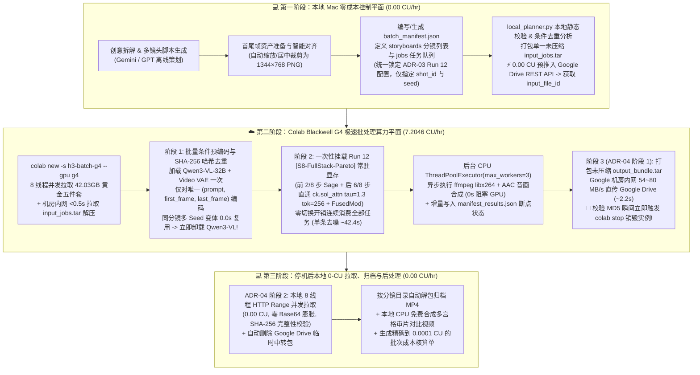

<!-- harness-ignore LNK001: outputs/ directory is ignored in git -->
# Experiment 05 设计方案：构建基于 `Run 12 [S8-FullStack-Pareto]` 的“本地零成本策划攒批 + 云端 G4 显存常驻批处理渲染”异构 CLI 视频生产工作流

> **状态**：✅ 已完成（2026-10-23 G4 实测验证闭环，完整报告见 [`report.md`](./report.md)，架构决策见 [`ADR-05`](../../docs/adr/0005-staged-batch-production-workflow.md)）  
> **目标硬件**：Google Colab NVIDIA RTX PRO 6000 Blackwell Server Edition（`--gpu g4`，`94.97 GiB` VRAM，`7.2046 CU/hr`）  
> **前置架构基石（ADR-01 ~ ADR-05 闭环锁定）**：
> - [ADR-01](../../docs/adr/0001-model-weights-loading-pipeline.md)：`Comfy-Org/MiniMax-H3` 黄金五件套（`42.03 GB`）+ `hf_xet` 8 线程并发直连加载
> - [ADR-02](../../docs/adr/0002-blackwell-gpu-and-sageattention-acceleration.md)：Blackwell G4 96GB 全模型显存常驻零换页
> - [ADR-03](../../docs/adr/0003-sol-attn-and-g4-pareto-frontier.md)：**全局唯一锁定 `Run 12 [S8-FullStack-Pareto]` 为默认标准推理配置**（前 2/8 步 `SageAttention` 稠密预热 + 后 6/8 步零拷贝直通 `ck.sol_attn` (`tau=1.3, extra_tokens=256`) + `MiniMaxH3FusedModulation`，单视频去噪 `41.56s~42.37s` / 端到端 `45.89s~46.72s` / `0.0918~0.0935 CU`，**不再分档**）
> - [ADR-04](../../docs/adr/0004-two-stage-gdrive-rest-egress-relay.md)：两段式零交互 Google Drive v3 REST API 云端内网极速卸载（阶段 1 机房内网直传后毫秒级 `colab stop` $\rightarrow$ 阶段 2 本地 8 线程 `HTTP Range` 零 CU 并发拉取）
> - [ADR-05](../../docs/adr/0005-staged-batch-production-workflow.md)：锁定三阶段异构批处理生产工作流（0-CU GDrive 双向中转 + 阶段式 `Qwen3-VL` SHA-256 去重预编码后立即卸载 + 常驻 `Run 12` 模式 P1 单流 GPU + 后台异步 CPU `ffmpeg`）

---

## 1. 实验背景与核心设计目标（Objectives）

在实验 01 ~ 04 中，我们已经正式锁定 **`Run 12 [S8-FullStack-Pareto]`** 为唯一标准推理配置（单条 `1344×768 × 124 帧` 声画同源视频去噪 **`42.37s`** / 端到端 **`46.72s`** / **`0.0935 CU`**），并将尾端归档包的 GPU 回传占用时长压降至 **`~2.2s`（`0.0045 CU`）**。

然而，在真实自媒体视频生产中，每次新建 Colab G4 会话仍存在一项不可避免的**固定冷启动税（Fixed Cold-Start Tax，$T_{\text{cold}} \approx 175 \sim 205\text{ s}$，折合 $C_{\text{cold}} \approx 0.35 \sim 0.41\text{ CU}$）**，包括：
1. 容器启动与自定义节点编译/环境就绪（`~20s`）；
2. 并发拉取 `42.03 GB` 黄金五件套权重至 `/content` 并加载入显存（`~136s ~ 145s`）；
3. 算子 JIT 首次编译与 1 步轻量预热（`~14s ~ 18s`）。

若每次挂载 GPU 仅交互式单跑 1 条视频，固定冷启动税占整场会话总成本高达 **`79% ~ 81%`**；而若遵循 **“本地零 CU 策划攒批、云端零等待全常驻连续跑 `Run 12`、跑完 2 秒即销毁”** 铁律，将 $M$ 条分镜/种子任务攒批单次提交，固定冷启动税将被摊薄为 $\frac{C_{\text{cold}}}{M}$。

并且，因为**全局唯一锁定 `Run 12 [S8-FullStack-Pareto]`（不分档）**，云端引擎无需在任务之间克隆模型或反复重打注意力补丁——**`DiT` 在启动时一次性注入 `Run 12` 算子栈并永久常驻显存，任务切换开销严格为 `0.000s`**！

**Experiment 05** 重点完成以下 **三项核心批处理工程验证与微消融实验**：

1. **首尾双端 0-CU Google Drive REST 内网投料与卸载闭环（Zero-CU Ingress & Egress Staging）**：
   - 在本地**未启动 G4 前（`0.00 CU`）**先将打包好的 `input_jobs.tar` 推入 Google Drive REST API；
   - G4 启动后利用 8 线程拉取 HF 权重的并发间隙，走 Google 机房内网（`< 0.5s`）拉下 `input_jobs.tar` 解压（彻底消除本地上传占用 GPU 的等待时间）；
   - 队列全部渲染完毕后调用 [ADR-04](../../docs/adr/0004-two-stage-gdrive-rest-egress-relay.md) 在 `~2s` 内推回 Google Drive 并立即 `colab stop`。
2. **阶段式批量条件预编码 + SHA-256 条件哈希去重缓存（Staged Conditioning Pre-Encode & Deduplication）**：
   - 对比验证：在多任务队列中（尤其是同一分镜跑多个 `seed` 变体抽卡时），通过计算 `cond_hash = sha256(prompt + neg_prompt + first_frame_sha256 + last_frame_sha256)` 仅对唯一分镜执行一次 `Qwen3-VL-32B` + `Video VAE Encode`，同分镜不同 Seed 任务 **`0.00s` 直接复用潜变量条件**；
   - 全部唯一分镜编码完成后**立即彻底卸载 `15.69 GB` 的 `Qwen3-VL-32B`**，释放整洁显存空间再进入连续 `Run 12` `DiT` 去噪阶段。
3. **连续 `Run 12` 渲染流水线微消融：单流 GPU + 异步 CPU `ffmpeg`（模式 P1）vs. 主/副双 CUDA Stream 并发重叠 VAE 解码（模式 P2）**：
   - 由于 `Run 12` 去噪期间 Blackwell G4 的 SM 与 GDDR7 带宽已处于 `~98%` 满载状态，Experiment 05 在真实 G4 上严格对比：
     - **流水线模式 P1（Sequential GPU + Async CPU Muxing）**：GPU 主流依次执行 `DiT [Run 12] (K) -> VAE Decode (K)`，解码出的主机内存张量立即交由后台 `ThreadPoolExecutor(max_workers=3)` 异步执行 `ffmpeg` H.264+AAC 封装，GPU 零等待切入 `DiT [Run 12] (K+1)`；
     - **流水线模式 P2（Dual CUDA Stream Overlap + Async CPU Muxing）**：任务 $K$ 的 `VAE Decode` 在独立 `torch.cuda.Stream()` 上与任务 $K+1$ 的 `DiT [Run 12]` 去噪并发执行，实测其端到端净耗时收益、SM 争用影响及瞬时显存峰值变化。

---

## 2. 异构生产工作流全景架构图（System Architecture）



---

## 3. 标准化任务清单规范（`batch_manifest.json` Schema）

由于全局唯一锁定 [`ADR-03`](../../docs/adr/0003-sol-attn-and-g4-pareto-frontier.md) 的 **`Run 12 [S8-FullStack-Pareto]`**，清单格式极为简洁直观：仅包含 **`storyboards`（分镜资产层）** 与 **`jobs`（渲染任务队列层，仅需指定 `job_id`、`shot_id`、`seed`）**：

```json
{
  "batch_id": "exp05_run12_batch_6jobs",
  "title": "Experiment 05 自媒体多镜头批处理验证清单 (全量锁定 ADR-03 Run 12 [S8-FullStack-Pareto], 3 分镜 × 6 任务)",
  "resolution": [1344, 768],
  "num_frames": 124,
  "fps": 24,
  "steps": 8,
  "cfg": 1.0,
  "storyboards": [
    {
      "shot_id": "shot_01_cyber_mouse_orbit",
      "title": "分镜 1：透明电竞鼠标暗场蓝橙流光环绕推轨",
      "prompt": "Editorial tech product film. The transparent gaming mouse from <Picture 1> in its original scene...",
      "negative_prompt": "",
      "first_frame": "assets/shot01_first.png",
      "last_frame": "assets/shot01_last.png"
    },
    {
      "shot_id": "shot_02_neon_circuit_pulse",
      "title": "分镜 2：鼠标透明外壳内部微距电路脉冲呼吸与低角度滑轨",
      "prompt": "Macro commercial product cinematography. Low-angle dolly slide across the transparent gaming mouse...",
      "negative_prompt": "",
      "first_frame": "assets/shot01_first.png",
      "last_frame": "assets/shot01_last.png"
    },
    {
      "shot_id": "shot_03_hero_reveal_finale",
      "title": "分镜 3：终章顶光掠影揭幕与对称定格特写",
      "prompt": "High-contrast luxury hardware reveal film. The transparent gaming mouse from <Picture 1> emerges...",
      "negative_prompt": "",
      "first_frame": "assets/shot01_first.png",
      "last_frame": "assets/shot01_last.png"
    }
  ],
  "jobs": [
    {"job_id": "job_01_shot01_seed42",   "shot_id": "shot_01_cyber_mouse_orbit",  "seed": 42,   "note": "分镜1 种子42 (Run 12 标准配置)"},
    {"job_id": "job_02_shot01_seed108",  "shot_id": "shot_01_cyber_mouse_orbit",  "seed": 108,  "note": "分镜1 种子108 变体 (0.0s 复用分镜1条件张量)"},
    {"job_id": "job_03_shot01_seed2026", "shot_id": "shot_01_cyber_mouse_orbit",  "seed": 2026, "note": "分镜1 种子2026 变体 (0.0s 复用分镜1条件张量)"},
    {"job_id": "job_04_shot02_seed77",   "shot_id": "shot_02_neon_circuit_pulse", "seed": 77,   "note": "分镜2 种子77 (Run 12 标准配置)"},
    {"job_id": "job_05_shot02_seed888",  "shot_id": "shot_02_neon_circuit_pulse", "seed": 888,  "note": "分镜2 种子888 变体 (0.0s 复用分镜2条件张量)"},
    {"job_id": "job_06_shot03_seed99",   "shot_id": "shot_03_hero_reveal_finale", "seed": 99,   "note": "分镜3 种子99 终章镜头 (Run 12 标准配置)"}
  ]
}
```

---

## 4. 目录结构（Code Organization）

遵循统一的 `code/` 与 `outputs/` 分离规范，本实验目录结构如下：

```text
experiments/05-production-batch-workflow/
├── README.md                          # 本设计方案与工作流使用手册
├── report.md                          # G4 实测完成后生成的完整实验报告
├── code/
│   ├── manifest_schema.py             # 清单 Schema 校验、锁定 Run 12 常量与 SHA-256 条件哈希计算
│   ├── local_planner.py               # 本地 0-CU 资产检查、input_jobs.tar 打包与 GDrive 0-CU 预推
│   ├── remote_batch_engine.py         # 云端 G4 阶段式 Run 12 批处理引擎（含条件去重缓存与 P1/P2 流水线消融）
│   ├── colab_batch_runner.py          # 本地无人值守全生命周期一键调度器（0-CU 投料 -> G4 渲染 -> 2s GDrive 卸载停机 -> 0-CU 拉回解包）
│   ├── render_visuals_local.py        # 本地 0-CU 渲染批处理摊薄成本曲线与多镜头审片对比图
│   └── sample_batch_manifest.json     # 3 分镜 × 6 任务（全量锁定 Run 12）生产批次示例清单
└── outputs/                           # 实测产出视频、遥测 JSON、账本审计摘录与可视化图表
```
