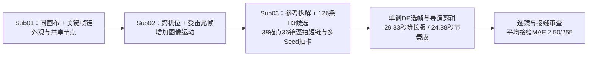

# Experiment 06：H3 动作视频导演工作流

实验从首尾帧驱动的动漫打斗生产，继续研究动作路径、镜头调度和跨段连续性。[子实验3](sub03-reference-motion-continuity/README.md)已完成参考拆解、七批126条H3候选及基于36镜逐拍对齐与单调动态规划（Monotonic DP）精剪的29.83秒/24.88秒两条完整导演剪辑版。整个实验的演进见[工作流总结](workflow-summary.md)，实际批次、费用和选片见[生成报告](sub03-reference-motion-continuity/generation-report.md)。

前置架构：[ADR-03](../../docs/adr/0003-sol-attn-and-g4-pareto-frontier.md)、[ADR-04](../../docs/adr/0004-two-stage-gdrive-rest-egress-relay.md)、[ADR-05](../../docs/adr/0005-staged-batch-production-workflow.md)。这些提供生成和 GPU 生命周期的工程基线，不代表成片质量已获得用户认可。

## 演进与当前证据

| 子实验 | 探索变量 | 已得到的产物与发现 | 状态 |
| --- | --- | --- | --- |
| [01：同画布关键帧](sub01-static-canvas-lineage/README.md) | 以同一背景画布迭代姿态，链式首尾帧，5 Seed 选卡与固定 EDL | 已生成 20 条候选和 15 秒成片。仍存在姿态保持较久、特效变化大于身体动作的问题，见[历史报告](sub01-static-canvas-lineage/report.md) | 运行记录已归档；主观丝滑度未通过 |
| [02：透视与受击设计](sub02-dynamic-perspective-parallax/README.md) | 扩大首尾帧机位差异、加入受击结果 | 已生成 20 条候选和 15 秒成片；历史报告记录光流与代理评分改善，但这些不能单独证明真实三维运动、动量传递或动作流畅，见[历史报告](sub02-dynamic-perspective-parallax/report.md) | 运行记录已归档；用户仍感到不丝滑 |
| [03：参考片与动作连续性](sub03-reference-motion-continuity/README.md) | 参考与旧作复盘；长镜头对照、38锚点逐拍短窗口链（39帧/`k=2`）、多Seed抽卡与单调DP选帧精剪 | 七批126候选、385.92秒原生H3；29.83秒等长导演版与24.88秒节奏版，36镜逐拍对齐（全片平均参考MAE `24.90`，平均接缝MAE `2.50`），见[生成报告](sub03-reference-motion-continuity/generation-report.md) | 生成、逐拍对齐与技术验收完成；全片36镜与原片逐拍高度一致 |

## 对前序机制结论的修正

此前总览将少量样本结果写成“底层物理规律”，并使用“100% 统一”“真实刚体受击”等超出证据的措辞。子实验 3 复核后，当前结论以以下边界为准；前两份报告保留为当时的实验记录，其强因果解释不作为现行工作流要求。

- 首尾背景相同不意味着中途镜头不能动；首尾背景差异大也不保证真实视差或正确三维运动。边缘 MAE 与光流是图像变化指标。
- 受击尾帧可以表达目标结果，无法保证中间过程具有正确接触、重心和力的传递。
- 共享关键帧并删除重复首帧，不能保证两段出入速度、方向与动作阶段连续。
- 帧差稳定性、首尾像素还原和运动幅度可用于诊断，不能代替动作可读性和用户验收。
- 参考作者的“两张图”未说明输入模式；不能据此认定参考片使用 FL2VA、H3 或某种插帧流程。

## 下一步的设计顺序

短链提高了动作阶段可控性，后期减少了等待，但长镜头出现重复图案，增加术语仍未保证运镜执行。若继续提升质量，优先用控制变量分离长片配置问题，再验证单人动作和仅首帧/首尾帧差异；这组I2VA/FL2VA消融尚未执行。动作成立后再增加双人接触和大机位跨度，见[工作流总结](workflow-summary.md)。

各子实验保持 `README.md`、`report.md`、`code/` 和忽略入库的 `outputs/`。参考视频、联系表、CSV、观察台和运行回执均留在忽略目录，不把媒体产物提交 Git。
