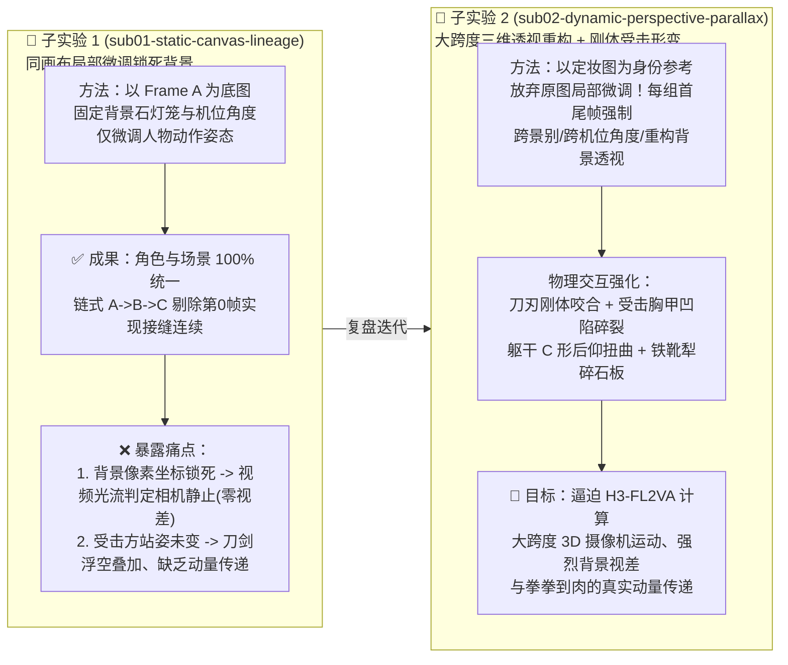

<!-- harness-ignore LNK001: outputs/ directory is ignored in git -->
# Experiment 06：面向自媒体短视频与高燃动漫打斗（Sakuga）的 `H3-FL2VA` 导演工作流迭代探索

> **实验定位**：探索并固化一套适用于 `MiniMax H3-Base-FL2VA`（首尾帧驱动声画同源生成）的高燃动漫打斗（Ufotable Sakuga 风格）工业化生产与自动化导演剪辑标准工作流。  
> **前置架构基石**：[ADR-03](../../docs/adr/0003-sol-attn-and-g4-pareto-frontier.md)（`Run 12 [S8-FullStack-Pareto]`）· [ADR-04](../../docs/adr/0004-two-stage-gdrive-rest-egress-relay.md)（2 秒机房内网卸载）· [ADR-05](../../docs/adr/0005-staged-batch-production-workflow.md)（`cond_hash` SHA-256 条件去重预编码与常驻 P1 批处理）

---

## 1. 迭代演进脉络（Iterative Exploration Overview）

本实验分为两个递进的子实验目录，完整记录从“同画布微调锁背景（Sub-Exp 01）”到“同源资产参考 + 大跨度三维透视重构与刚体受击反馈（Sub-Exp 02）”的方法论演进：



| 子实验目录 | 核心首尾帧生成策略 | 摄像机空间调度与背景视差 | 兵器碰撞体积与受击反馈 | 状态与报告 |
| :--- | :--- | :--- | :--- | :---: |
| **[`sub01-static-canvas-lineage`](./sub01-static-canvas-lineage/README.md)** | 基于 `Frame A` 原图画布局部微调姿态，背景建筑与石灯笼像素坐标严格锁定 | **静止机位（零视差）**：因首尾帧背景像素重合，`Video VAE` 锚定迫使模型固定镜头，人物呈原地摆姿 | **图层叠加态**：受击方（黑甲武士）重心与躯干未发生位移，缺乏刚体动量传递 | ✅ 已归档<br>（[实测报告](./sub01-static-canvas-lineage/report.md)） |
| **[`sub02-dynamic-perspective-parallax`](./sub02-dynamic-perspective-parallax/README.md)** | 仅将 `Frame A` 作为**资产身份参考（Identity Reference）**；尾帧强制重构三维透视、切换俯仰机位与景别占比 | **大跨度 3D 运镜与强视差**：如 `24mm` 越肩俯拍远景 $\rightarrow$ `14mm` 贴地虫视广角仰拍（**Shot 1 背景光流提升 `2.29x`、峰值 `2.85x`**）$\rightarrow$ `120°` 环绕侧跟拍 $\rightarrow$ `30m` 高空鸟瞰急拉 | **真实刚体受击形变**：刀刃死锁咬合，受击者胸甲凹陷碎裂、躯干 C 形向后折弯、双膝失衡跪退犁出深沟（**Shot 2 `S_fl2v` 达 `83.50`、`ProdQ` 达 `85.99`**） | ✅ 已完成<br>（[实测报告](./sub02-dynamic-perspective-parallax/report.md)） |

---

## 2. 核心工程洞察：为什么“锁背景微调”只适合文戏，而打斗必须“重构透视”？

通过子实验 1（[`sub01-static-canvas-lineage`](./sub01-static-canvas-lineage/report.md)）的真实生成结果复盘，我们提炼出 `MiniMax-H3 FL2VA` 首尾帧控制的一条底层物理规律：

1. **像素锚定优先级高于文本运镜标签（VAE Latents Override Text Camera Tags）**：
   - 在 `H3-FL2VA` 中，`first_frame` 与 `last_frame` 直接通过 `Video VAE` 编码进第 `0` 帧与第 `N-1` 帧的空间潜变量网格。
   - 如果 `<Picture 1>` 和 `<Picture 2>` 中的背景建筑（如两侧石灯笼、屋顶破洞）处于相同的像素位置 `(x, y)`，模型的 3D 时空注意力在求解潜空间运动轨迹时，**边界条件强制约束背景光流 $\Delta \vec{v}_{\text{bg}} = \vec{0}$**。此时无论文本提示词里写多么强烈的 `[Tracking shot]` 或 `[Arc shot]`，模型都无法移动摄像机，只能在静止背景前对前景人物做原地插值，产生“纸片人摆姿势”的僵硬感。
   - **破局方案（Sub-Exp 02）**：要让视频产生真正的飞碟社 3D 环绕运镜与空间推进感，**尾帧必须彻底改变摄像机机位角度与透视消失点**（例如首帧从左后方越肩俯看庭院，尾帧切至贴地仰拍屋檐与交锋双刃），用首尾帧之间巨大的背景几何位移差（$\Delta \vec{v}_{\text{bg}} \gg 0$）逼迫模型合成真实的三维空间运动与背景视差（Parallax）！
2. **动量守恒的视觉表达：用“受击形变结果”逼迫模型反推“冲击过程”**：
   - 视频扩散模型本身不懂牛顿力学，但极度擅长补全首尾两帧之间的形态过渡。
   - 如果尾帧里防守方仍然四平八稳地站立，模型生成的挥刀动作必然是轻飘飘的“点到为止”；只有当尾帧明确画出**防守方被劈得胸甲凹陷迸裂、身体后仰折成弓形、双脚在石板上向后滑行犁出碎石沟壑**时，模型为了在 `4~5 秒` 内合理衔接这一结果，才会在中间帧自动合成极具重量的暴力挥砍与冲击波传递！

---

## 3. 目录结构导航

```text
experiments/06-sakuga-fl2va-director-workflow/
├── README.md                                      # 本文件：Experiment 06 迭代演进总览与物理机制总结
├── sub01-static-canvas-lineage/                   # 子实验 1 (已归档)：同画布局部微调锁背景方案
│   ├── README.md                                  # 子实验 1 设计规范
│   ├── report.md                                  # 子实验 1 G4 实测报告 (20 视频 1.7766 CU 账本与链式裁剪铁律)
│   ├── code/                                      # 子实验 1 清单、关键帧资产与导演精剪脚本
│   └── outputs/                                   # 子实验 1 产出故事板、4x5 抽卡矩阵与 15.0s 成片
└── sub02-dynamic-perspective-parallax/            # 子实验 2 (当前迭代)：三维透视重构 + 强视差 + 刚体受击反馈方案
    ├── README.md                                  # 子实验 2 透视重构与物理受击设计方案
    ├── code/                                      # 子实验 2 清单、大跨度透视关键帧与导演精剪脚本
    └── outputs/                                   # 子实验 2 故事板、干跑与实测产物
```
