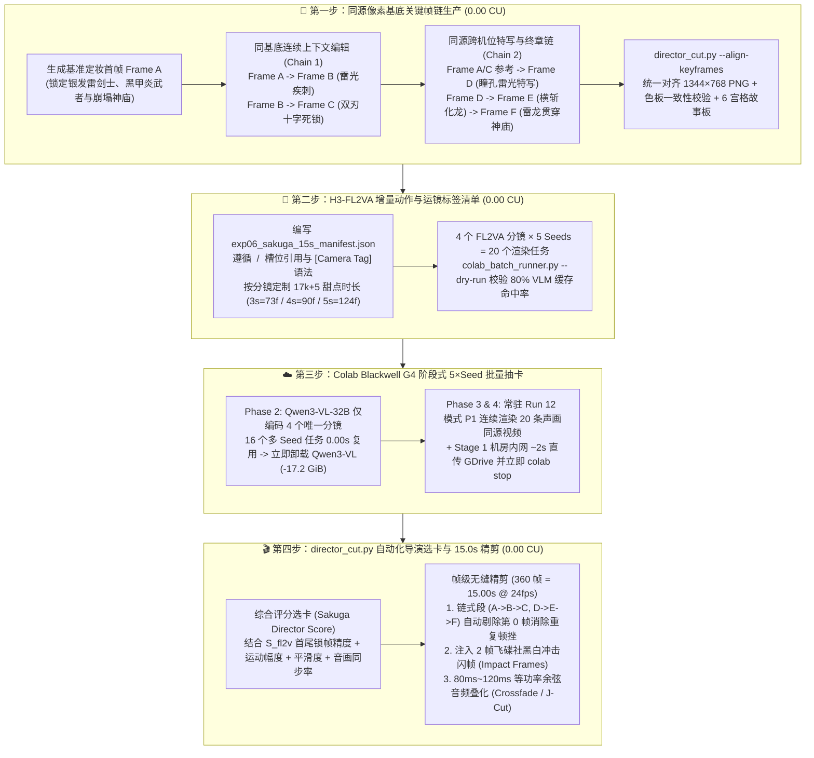

<!-- harness-ignore LNK001: outputs/ directory is ignored in git -->
# Experiment 06 设计方案：面向自媒体短视频与高燃动漫打斗（Sakuga）的“同源关键帧链 + `H3-FL2VA` 增量标签 + 5×Seed 抽卡 + 导演自动精剪”标准工作流

> **状态**：✅ 已完成（2026-10-24 G4 20 任务批量抽卡与 15.00s 导演精剪实测闭环，完整报告见 [`report.md`](./report.md)）  
> **目标硬件**：本地 macOS 0-CU 策划与导演剪辑控制平面 + Google Colab NVIDIA RTX PRO 6000 Blackwell Server Edition（`--gpu g4`，`94.97 GiB` VRAM，`7.2046 CU/hr`）  
> **前置架构基石**：
> - [ADR-03](../../../docs/adr/0003-sol-attn-and-g4-pareto-frontier.md)：全局唯一锁定 `Run 12 [S8-FullStack-Pareto]`（首尾帧锚定精度 `S_fl2v > 94`）
> - [ADR-04](../../../docs/adr/0004-two-stage-gdrive-rest-egress-relay.md)：两段式零交互 Google Drive REST API 云端内网极速卸载与毫秒级 `colab stop`
> - [ADR-05](../../../docs/adr/0005-staged-batch-production-workflow.md)：三阶段异构批处理生产工作流（`cond_hash` SHA-256 条件去重预编码 + `Qwen3-VL-32B` 立即卸载 + 模式 P1 单流连续渲染）

---

## 1. 实验背景与核心方法论（Methodology）

在自媒体短视频（尤其是 **AI 漫剧、飞碟社 Ufotable 风格高燃打斗、连续叙事短片**）创作中，传统“纯文生视频（T2V）+ 固定 5 秒硬拼”存在三大致命痛点：
1. **跨镜头角色与环境严重漂移（Character & Scene Drift）**：独立文生图或纯文生视频无法锁定同一套服饰纹理、刀刃样式与神庙建筑结构。
2. **链式接缝卡顿与音频爆音（Boundary Freeze & Audio Pop）**：当第一段视频为 `Frame A -> Frame B`、第二段为 `Frame B -> Frame C` 时，两段视频首尾共享同一张静态图 `B`；若直接拼接，画面会在 `B` 连续静止停留 2 帧（`83ms`），产生肉眼可见的顿挫，且独立生成的声画同源音轨在硬切处易出现波形跳变爆音。
3. **单镜头时长死板与首尾动作疲软（Pacing Stiffness）**：AI 视频末尾常出现动作卸力，而真实番剧打斗依赖 **`2.5s ~ 4.8s` 的非对称变速蒙太奇**、**动作峰值切镜（Cut on Action）**以及 **黑白高反差冲击闪帧（Impact Frames）**。

**Experiment 06** 将自媒体 AI 视频创作固化为一套可复用的 **四步导演级标准工作流（Four-Step FL2VA Director Pipeline）**：



---

## 2. 四大核心规范详解（Reusable Workflow Rules）

### 2.1 规范一：同源基底关键帧链（Shared-Lineage Keyframing）
- **同机位连续动作链（`Frame A -> Frame B -> Frame C`）**：严禁使用两段独立文生图提示词分别抽首尾帧。必须以 `Frame A` 为输入参考底图，通过多模态上下文编辑仅修改人物动作姿态与刀光特效产出 `Frame B`，再由 `Frame B` 演化出 `Frame C`。
- **同源跨机位蒙太奇切镜（`Frame C || Frame D -> Frame E -> Frame F`）**：当需要切入面部/瞳孔特写或大远景时，将 `Frame A` 与 `Frame C` 作为参考图传入生图工具，确保特写镜头 `Frame D` 中的发色、瞳色、羽织纹样与背景神庙色温 100% 继承自同一视觉资产。

### 2.2 规范二：`MiniMax-H3 FL2VA` 增量动作与运镜标签公式
由于 `Qwen3-VL-32B` 直接读取 `<Picture 1>` 与 `<Picture 2>` 的视觉 Token，提示词专注于描述**两帧之间的物理运动增量、方括号运镜指令与声效层次**：

```text
[0.00s] <Picture 1> is fully referenced as the starting frame. [风格与光影锚点]. The camera [Camera Tag] with [amplitude] at [speed]... [描述从 <Picture 1> 到 <Picture 2> 的动作轨迹、受击物理反馈与粒子演化]. At the final frames, the scene resolves into <Picture 2>. Audio: [高冲击物理音效 Foley、环境声与能量共鸣].
```

### 2.3 规范三：15.0 秒（360 帧 @ 24fps）变速分镜与帧级精剪蓝图

| 分镜序号与 `shot_id` | 关键帧链路 | `17k+5` 原始生成规格 | 导演精剪保留帧区间 | 精剪净时长 | 衔接与转场处理（`director_cut.py`） |
| :--- | :---: | :---: | :---: | :---: | :--- |
| **`shot_01_thunder_dash`** | `Frame A -> B` | `4.0s` (`90 帧 / 3.75s`) | `Frames [0 .. 83]` (`84 帧`) | **`3.50s`** | 在贴地雷光冲刺速度峰值处切出，砍掉末尾 `6 帧` 缓冲 |
| **`shot_02_blade_clash_shockwave`** | `Frame B -> C` | `5.0s` (`124 帧 / 5.17s`) | `Frames [1 .. 101]` (`101 帧`) | **`4.21s`** | **链式无缝接力**：剔除 `Frame 0`（避免图片 `B` 重复停留 2 帧卡顿）+ `80ms` 音频叠化 |
| **`shot_03_eye_awakening_slash`** | `Frame D -> E` | `3.0s` (`73 帧 / 3.04s`) | `Frames [2 .. 61]` (`60 帧`) | **`2.50s`** | **跨机位快切（J-Cut）**：高压电流嗡鸣声提前 `120ms` 切入，直取瞳孔骤缩与横斩爆发段 |
| **`shot_04_dragon_finale_blast`** | `Frame E -> F` | `5.0s` (`124 帧 / 5.17s`) | `Frames [1 .. 115]` (`115 帧`) | **`4.79s`** | **链式无缝接力 + 冲击闪帧**：剔除 `Frame 0`（图片 `E` 重复帧），前 `2 帧` 注入飞碟社**黑白正反冲击闪帧（Impact Frames）** |
| **全片总计（Master Cut）** | **6 张同源关键帧** | **原始总长 `411 帧` (`17.13s`)** | **精剪总长 `360 帧`** | **`15.00s`** | **零重复静止帧、零音频拼接爆音、非对称变速高燃节奏** |

---

## 3. 目录结构与执行命令（CLI Usage）

```text
experiments/06-sakuga-fl2va-director-workflow/
├── README.md                              # 本工作流设计规范与操作手册
├── code/
│   ├── assets/                            # 6 张 1344×768 同源关键帧 PNG (Frame A ~ Frame F)
│   ├── exp06_sakuga_15s_manifest.json     # 4 分镜 × 5 Seeds = 20 任务标准批处理清单
│   └── director_cut.py                    # 0-CU 关键帧对齐、故事板合成、自动选卡与 15.0s 导演精剪器
└── outputs/                               # 故事板大图、干跑计划、20 条候选视频与 15.0s 最终成片 (Git 忽略)
```

```bash
# Step 1 (0.00 CU): 对齐 Frame A..F 为 1344x768 并生成 6 宫格同源故事板与色板一致性报告
python3 experiments/06-sakuga-fl2va-director-workflow/code/director_cut.py --align-keyframes

# Step 2 (0.00 CU): 干跑校验 4 分镜 × 5 Seeds = 20 任务清单、SHA-256 条件去重率与 CU 成本预估
python3 studio/api/colab_batch_runner.py \
  --manifest experiments/06-sakuga-fl2va-director-workflow/code/exp06_sakuga_15s_manifest.json \
  --dry-run

# Step 3 (Colab G4): 一键上云执行 20 条声画同源视频批量抽卡并 0-CU 拉回本地
python3 studio/api/colab_batch_runner.py \
  --manifest experiments/06-sakuga-fl2va-director-workflow/code/exp06_sakuga_15s_manifest.json \
  --session h3-exp06-g4

# Step 4 (0.00 CU): 导演自动选卡 + 剔除链式重复首帧 + 黑白闪帧注入 + 音频叠化 -> 输出 15.0s 成片
python3 experiments/06-sakuga-fl2va-director-workflow/code/director_cut.py \
  --select-and-cut studio/outputs/exp06_sakuga_fight_15s/1
```
