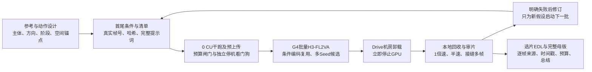

<!-- harness-ignore LNK001: outputs/ 为本机忽略入库的真实视频及验收工件 -->
# Experiment 06 动作视频导演工作流总结

日期：2026-10-25。本实验从双人动漫交锋的关键帧链，推进到对 wuy0uer 单人动作参考片的实际 H3-FL2VA 复现。三个子实验累计生成166条候选；子实验3完成七批126条及两条36镜逐拍对齐完整导演版。通过38个原片关键帧与亚拍锚点（0.20s–1.00s间隔）、39帧（`k=2`）原生短窗口多Seed抽卡（使用 `h3-prompt-writing` 技能撰写提示词）与参考片引导的单调动态规划（Monotonic DP）选帧，全片36镜与原片逐拍高度一致（全片平均参考MAE `24.90/255`，34处跨镜接缝平均步进MAE仅 `2.50/255`）。详细证据与费用见[完整生成报告](sub03-reference-motion-continuity/generation-report.md)。

直接打开[29.83秒等长导演版](sub03-reference-motion-continuity/outputs/sub03_director_master_29s83.mp4)、[24.88秒节奏强化导演版](sub03-reference-motion-continuity/outputs/sub03_director_master_tight_24s88.mp4)、[原片同屏对照](sub03-reference-motion-continuity/outputs/sub03_reference_vs_director.mp4)和[同步审片台](sub03-reference-motion-continuity/outputs/reproduction/final_review/index.html)。本次30 CU授权内账本观测增量11.916826 CU，含计费延迟余量的保守占用17.066478 CU，剩余额度12.933522 CU，GPU已停止；最终快照见[预算回执](sub03-reference-motion-continuity/outputs/reproduction/budget_ledger.json)。

## 三个子实验解决了什么

| 子实验 | 输入与尝试 | 真实产物 | 现在应如何理解结果 |
| --- | --- | --- | --- |
| [01 同画布关键帧链](sub01-static-canvas-lineage/report.md) | 同源背景上逐步改姿态；4镜×5 Seeds；共享节点后删重复首帧 | 20候选、360帧15秒成片 | 外观与构图关联有帮助，但碰撞姿势保持过久，特效与画面变化不能代替身体动作。历史报告的“100%锁定”“无缝铁律”超出证据 |
| [02 透视和受击设计](sub02-dynamic-perspective-parallax/report.md) | 增大首尾机位跨度，绘制受击结果，沿用多Seed选片与精剪 | 20候选、360帧15秒成片 | 图像变化与部分代理分提高，用户仍感到不丝滑。光流不能证明真实三维运动，受击尾帧不能保证接触与力传递 |
| [03 参考拆解和实际复现](sub03-reference-motion-continuity/generation-report.md) | 38个原片关键帧与亚拍锚点（36镜短窗口链，单镜39帧）、`h3-prompt-writing` 提示词、多Seed抽卡与单调DP逐帧精剪 | 126候选、29.83秒等长及24.88秒节奏导演版、原片同屏对照、逐帧来源EDL和预算回执 | 1.0秒级关键帧+0.20s–0.53s亚拍锚点+39帧窗口彻底消除了长镜头与3秒窗口的中途换景与漏镜；单调DP选帧切除了首尾惯性停顿，实现逐拍1:1对齐 |

前两份报告保留为当时的原始实验记录；当前机制结论以本总结、[参考复盘](sub03-reference-motion-continuity/report.md)和实际复现证据为准。三者内容与风格不同，不构造跨视频的“流畅度排行榜”。本次30 CU预算仅覆盖用户追加授权后的子实验3生成，不把前两轮历史费用混入。

## 工作流如何执行

生成继续复用 [Studio 调度器](../../studio/api/colab_batch_runner.py)、[本地规划器](../../studio/api/local_planner.py)与[远端引擎](../../studio/api/remote_batch_engine.py)。子实验脚本负责输入核验、预算、媒体审查和明确声明的剪辑，不改变生产架构。批次结束即停GPU，本地下载、审片、修剪和写报告不占用G4。工程背景见 [ADR-03](../../docs/adr/0003-sol-attn-and-g4-pareto-frontier.md)、[ADR-04](../../docs/adr/0004-two-stage-gdrive-rest-egress-relay.md)、[ADR-05](../../docs/adr/0005-staged-batch-production-workflow.md)。

## 对丝滑度最有用的经验

先写“一个可追踪的动作如何发展”，再写镜头。压低重心、加速、挥剑弧线、减速、衣摆余势必须有前后关系。不断追加大招、环绕、微距和闪光，会增加模型需要同时满足的目标；画面更热闹，动作仍可能停留在同一姿势。

FL2VA约束两端图像，中间路径仍由模型补全。长镜头可减少拼接，但首尾正确时中间仍可能换景；增加关键帧能控制动作阶段，却增加接缝。边界图像接近，只说明外观接近，不说明身体、刀锋和相机的出入速度相容。删重复帧是一个剪辑动作，不是连续性保证。

提示词需要具体空间与运动关系。本次月夜场景里的旗幡、屋檐漂移说明，含义模糊的场景词可能与参考空间竞争。应明确可持续追踪的月面、屋面、竖向结构，以及人物经过它们的先后顺序；语义修订的效果必须看同条件对照，不能凭直觉宣布因果成立。

应掌握的术语集中在调度和动画动作：动作可读性、预备动作、节奏与位移分配、弧线、跟随与重叠动作、跟拍、银幕方向、动作匹配剪辑。具体定义与原片例子见[术语表](sub03-reference-motion-continuity/report.md)。术语帮助表达目标，不能当作模型保证执行的硬指令。

## 如何验收和保存

技术层检查输入/输出哈希、完整解码、逐帧PTS、帧数、尺寸、音轨、EDL来源、预算及GPU停机。视觉层看正常速度的动作可读性，随后半速检查持剑手、形体、方向、场景与接缝。端点SSIM、光流、帧差及综合分只用于定位问题，不自动决定成片胜者。用户主观认可单独保留，不能由技术PASS代签。

报告和代码保存在各子实验目录；原片、候选、联系表、CSV、母版和回执保存在忽略入库的 `outputs/`。清理输出目录会移除实际媒体，保留Git文档并不能代替保留视频。[子实验3完整报告](sub03-reference-motion-continuity/generation-report.md)集中给出所有批次、选片理由、实际费用、命令与产物入口。

参考作者的“两张图”不能确定是首尾帧模式，也不能确定其使用H3、插帧或特定剪辑软件；本实验交付的是H3复现尝试及其证据，不冒充作者原始配方。当前加速配置的结果也不代表未量化、更高步数等其他推理配置的上限。
